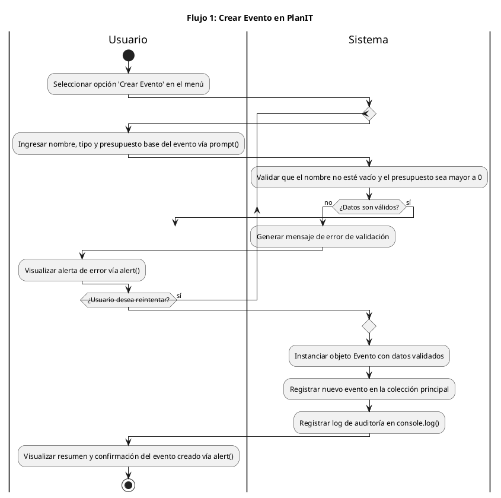

# 📐 Especificación del Arquitecto de Diagramas de Actividades (AO3)

**Rol:** Arquitecto de Diagramas de Actividades  
**Integrante:** Valeria Silva  
**Matrícula:** 156612  
**Fecha de inicio:** 20/10/2026  
**Estado:** Finalizado (Fase AT CLOSE)

---

# 🟢 FASE INICIAL (BEFORE)

## 1. Identificación de los 4 Flujos Principales

De acuerdo con las funcionalidades planificadas en `plan.md` y la estructura visual definida en el `mockup/` e `index.html` del proyecto, se modelarán los siguientes 4 flujos principales siguiendo el patrón **entrada → proceso → salida**:

### 1. Flujo 1: Navegación por el Menú Principal y Selección de Opción

- **Descripción:** Captura la opción seleccionada por el usuario en el menú interactivo (`prompt`) y la redirige al flujo de trabajo correspondiente.
- **Actores involucrados:** Usuario y Sistema.
- **Estructuras lógicas:** Condicional múltiple (`if-else` / `switch`) para evaluar la opción elegida y ciclo de repetición (`while`) para reiterar el menú en caso de opción inválida o hasta seleccionar salir.

### 2. Flujo 2: Ingreso y Validación de Datos de Entrada

- **Descripción:** Solicita datos al usuario mediante `prompt()`, valida que no estén vacíos y que correspondan al tipo de dato esperado (números/rango válido).
- **Actores involucrados:** Usuario y Sistema.
- **Estructuras lógicas:** Ciclo `while` o `repeat` que re-solicita el dato mientras sea inválido y decisiones condicionales `if-else` para mostrar mensajes de error específicos.

### 3. Flujo 3: Procesamiento y Cálculo de la Lógica de Negocio

- **Descripción:** Procesa los datos validados mediante algoritmos condicionales y operaciones matemáticas/colecciones (arrays/objetos) para calcular el resultado final.
- **Actores involucrados:** Sistema.
- **Estructuras lógicas:** Evaluaciones condicionales `if / else if / else` para aplicar reglas o descuentos según la lógica del dominio.

### 4. Flujo 4: Generación y Presentación de Resultados

- **Descripción:** Formatea la información calculada y genera la salida visual correspondiente para el usuario a través de `alert()` o `console.log()`.
- **Actores involucrados:** Sistema y Usuario.
- **Estructuras lógicas:** Estructuras secuenciales y condicionales para determinar si se muestra un resultado exitoso o una notificación de advertencia.

---

## 2. Análisis y Decisión sobre Swimlanes (Particiones)

- **Criterio de aplicación:** Se utilizarán *swimlanes* (carriles) con la sintaxis `|Usuario|` y `|Sistema|` en aquellos flujos donde exista una interacción directa de entrada/salida entre la persona y la aplicación.

- **Justificación:** Los Flujos 1, 2 y 4 involucran capturar datos o mostrar alertas en pantalla, por lo que separar visualmente las acciones que realiza el **Usuario** (ingresar datos, confirmar opciones) de las responsabilidades del **Sistema** (validar inputs, procesar algoritmos, renderizar respuestas) aclara los límites de responsabilidad y facilita la comprensión del Desarrollador JavaScript.

---

## 3. Checklist de Criterios de Aceptación (Planificación Inicial)

- [ ] **4 Diagramas completos:** Cada diagrama incluye inicio (`start`), fin (`stop`), actividades (`:Actividad;`), decisiones (`if-then-else`) y ciclos/bucles (`while`/`repeat`).
- [ ] **Uso de Swimlanes:** Separación explícita de carriles `|Usuario|` y `|Sistema|` en flujos con interacción.
- [ ] **Sintaxis PlantUML válida:** Todos los archivos `.puml` compilan sin errores de sintaxis.
- [ ] **Exportación de artefactos:** Generación y presencia de las parejas de archivos `.puml` (fuente editable) y `.png` (imagen exportada) para los 4 flujos en `docs/05-diagramas/01-diagrama-de-actividades/`.
- [ ] **Documentación general:** Creación de `docs/05-diagramas/01-diagrama-de-actividades/diagramas-doc.md` con índice, descripciones e imágenes embebidas.
- [ ] **Coherencia de diseño:** Verificación conjunta con el Desarrollador JavaScript de que la lógica modelada coincida con las funciones de `js/script.js`.

---

# 🔴 FASE FINAL (AT CLOSE)

## 1. Registro de Prompts y Contextos para GitHub Copilot Agent

### Contextos adjuntados al Prompt Original

- `plan.md`
- `index.html`
- `mockup/`

### Prompt Original enviado

```text
Como Arquitecto de Diagramas de Actividades para la AO3, genera el código fuente en PlantUML (.puml) para los 4 flujos principales de la aplicación siguiendo la estructura de plan.md e index.html:

1. Navegación por el Menú Principal y Selección de Opción
2. Ingreso y Validación de Datos de Entrada
3. Procesamiento y Cálculo de la Lógica de Negocio
4. Generación y Presentación de Resultados

Asegúrate de incluir start, stop, swimlanes (|Usuario| y |Sistema|), decisiones condicionales y bucles de repetición.
```

### Contextos adjuntados al Prompt de Rediseño

- `plan.md`
- `index.html`
- `mockup/`

### Prompt de Rediseño enviado

```text
Como Arquitecto de Diagramas de Actividades para la AO3 de PlanIT, genera el código fuente en PlantUML (.puml) para los 4 flujos principales del sistema siguiendo el patrón entrada -> proceso -> salida y alineados estrictamente con el dominio de la aplicación:

1. Crear Evento en PlanIT (solicitud de datos, validación iterativa y almacenamiento).
2. Calcular Presupuesto del Evento (recorrido de colección de ítems, aplicación de descuentos y verificación de tope).
3. Buscar en Catálogo de Proveedores (filtrado de colección según categoría o texto buscado).
4. Gestionar Lista de Invitados (registro y contabilización iterativa de confirmados y pendientes).

Asegúrate de incluir nodos start, stop, swimlanes (|Usuario| y |Sistema|), decisiones condicionales y ciclos de repetición con recorrido explícito de colecciones.
```

---

## 2. Extracto de Código Generado y Correcciones Manuales

### Extracto textual de código generado por Copilot Agent (Flujo 1 con sentencia `break` del commit `9284cad`)



### Ajustes y Correcciones Manuales Aplicadas

#### 1. Eliminación del patrón `break` en ciclos `repeat`

Se eliminó la instrucción `break` en el Flujo 1 porque generaba una flecha inconclusa colgando en la exportación PNG.

Se reemplazó por un flujo continuo con decisión explícita en el carril `|Sistema|` para cancelar la operación si los datos continúan siendo inválidos y el usuario desiste de reintentar.

#### 2. Adopción de `while...endwhile` para el recorrido de colecciones

En los Flujos 2, 3 y 4 se cambió la estructura de:

```plantuml
repeat
...
repeat while (...)
```

por:

```plantuml
while (...)
...
endwhile
```

La estructura `while` evalúa la condición **antes** de ingresar al bucle, lo que modela fielmente la iteración `for` o `forEach` sobre arreglos que pueden estar vacíos.

Mientras tanto, `repeat` ejecuta el cuerpo al menos una vez, incluso cuando la colección se encuentra vacía.

#### 3. Delimitación de Swimlanes

Se movieron las evaluaciones y los logs (`console.log()`) al carril `|Sistema|`, reservando `|Usuario|` exclusivamente para:

- Entrada de datos mediante `prompt()`.
- Visualización de mensajes mediante `alert()`.

---

## 3. Trazabilidad del Rediseño y Sincronización

### 3.1 Paso de Flujos Genéricos a Flujos de Negocio PlanIT

Se re-alinearon los cuatro diagramas desde etapas abstractas hacia las cuatro entidades funcionales del proyecto:

- `actividad-flujo-1-crear-evento`
- `actividad-flujo-2-calcular-presupuesto`
- `actividad-flujo-3-buscar-catalogo`
- `actividad-flujo-4-gestionar-invitados`

### 3.2 Sincronización

Se sincronizaron:

- Los archivos fuente `.puml`.
- Sus correspondientes imágenes `.png`.
- La tabla de trazabilidad **Flujo ↔ Función ↔ Spec** documentada en `diagramas-doc.md`.

---

## 4. Checklist Final de Verificación (Fase AT CLOSE)

- [x] **4 Diagramas completos:** Diagramas de actividades en PlantUML con `start`, `stop`, decisiones, bucles `while` y swimlanes.
- [x] **Sintaxis PlantUML válida:** Archivos `.puml` compilados e imágenes `.png` exportadas correctamente.
- [x] **Estructura de archivos:** Artefactos organizados en `docs/05-diagramas/01-diagrama-de-actividades/`.
- [x] **Documentación navegable:** Archivo `diagramas-doc.md` creado con índice, descripciones, precondiciones, postcondiciones e imágenes embebidas.
- [x] **Spec-Driven Development:** Fase BEFORE preservada como evidencia histórica y Fase AT CLOSE completada con la trazabilidad del rediseño y uso de GitHub Copilot Agent.
- [ ] **Coherencia de diseño:** Verificación conjunta con el Desarrollador JavaScript de que la lógica modelada coincida con las funciones de `js/script.js`.(Pendiente de realización al implementarse `script.js`)