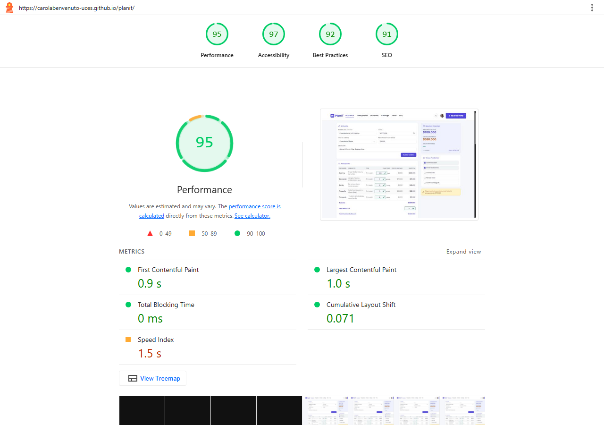
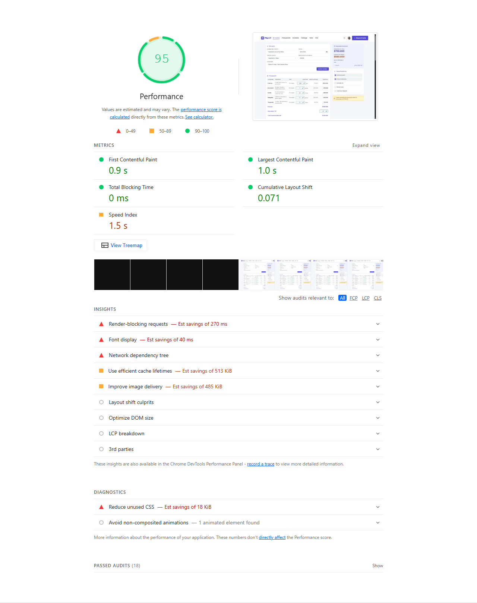
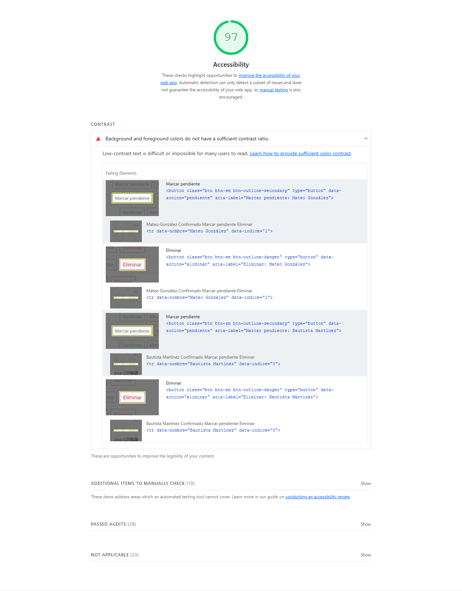
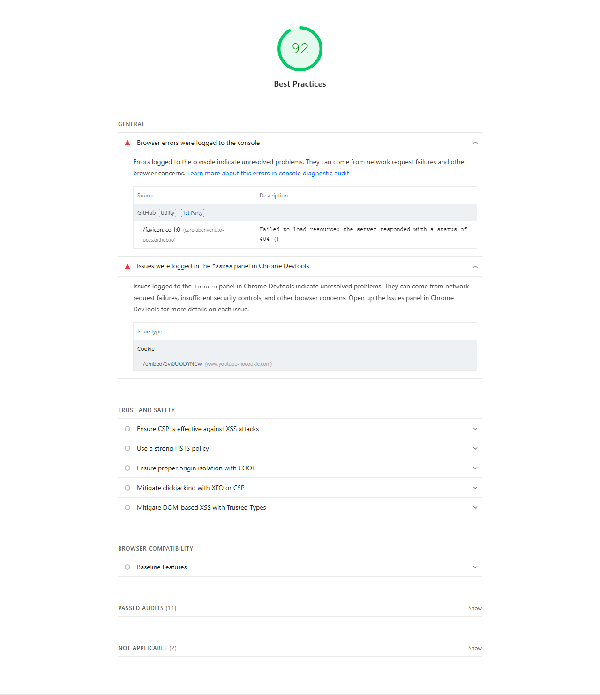
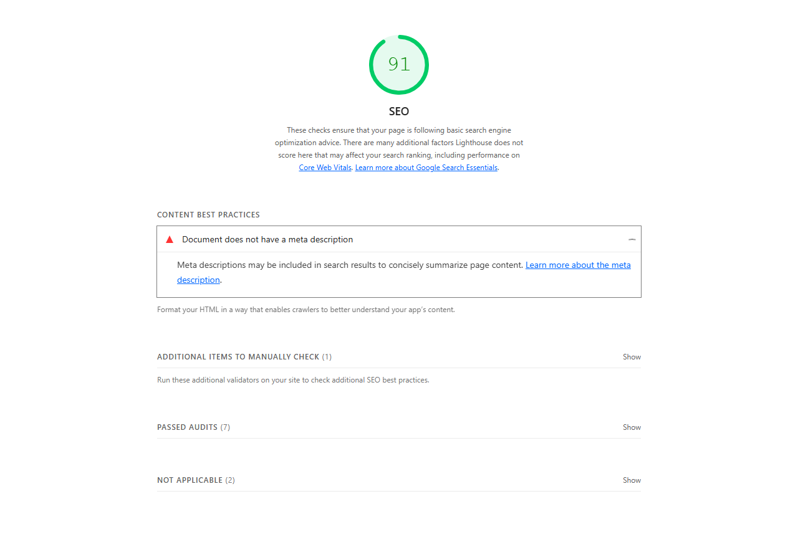

# Test Case 11 (TC11) — Auditoría Lighthouse: Baseline del Segundo Parcial

## Objetivo

Establecer la **línea base** de calidad del sitio publicado de PlanIT antes de integrar cualquier feature del Segundo Parcial, midiendo con Lighthouse las categorías Performance, Accessibility, Best Practices y SEO. Los resultados de este test case son la referencia contra la que se compararán el [Test Case 12 – Post-fetch](test-case-12-lighthouse-post-fetch.md) y, a través de él, el [Test Case 13 – Post-librería](test-case-13-lighthouse-post-library.md), según el plan de la sección 3 de [spec-tester-qa-segundo-parcial.md](../03-specs/segundo-parcial/spec-tester-qa-segundo-parcial.md).

---

## 1. Información general

| Campo | Valor |
|---|---|
| **Issue principal** | [#139](https://github.com/carolabenvenuto-uces/planit/issues/139) |
| **Responsable** | Valeria Silva (@ValeriaMSilva), Tester QA/JS |
| **Fecha de ejecución** | 25/11/2026, entre las 11:38 y las 11:39 (UTC−3) |
| **URL auditada** | [https://carolabenvenuto-uces.github.io/planit/](https://carolabenvenuto-uces.github.io/planit/) |
| **Rama publicada** | `master` @ `62e7e33` (merge de la PR #115, `release/cuarta-entrega`) |
| **Estado equivalente en `develop`** | `develop` @ `fe2a056` (merge de la PR #137, backport de la AO4). `git diff origin/master origin/develop` no devuelve diferencias: ambos árboles son idénticos. |
| **Verificación del despliegue** | El hash de `index.html`, `js/script.js` y `css/styles.css` servidos por GitHub Pages coincide byte a byte con el de `master`. |
| **Navegador** | Google Chrome 157.0.8103.80 (headless) |
| **Lighthouse** | 13.6.0 (CLI, mediante `npx`) |
| **Modo** | Desktop (`--preset=desktop`): pantalla emulada de 1350 px de ancho, limitación simulada de red (RTT 40 ms, 10 Mbps) y sin limitación de CPU |
| **Método** | 3 corridas consecutivas con Lighthouse CLI; se informa la mediana de cada categoría y de cada métrica |
| **Corrida mediana** | Corrida 3 (su puntaje de Performance, 95, coincide con la mediana) |

### Comando ejecutado

Se ejecutó tres veces, cambiando solo el sufijo de `--output-path`:

```text
npx --yes lighthouse@latest https://carolabenvenuto-uces.github.io/planit/ \
  --preset=desktop \
  --only-categories=performance,accessibility,best-practices,seo \
  --output=html --output=json \
  --output-path=./run-N \
  --chrome-flags="--headless=new" --quiet
```

Las capturas se tomaron con Playwright (Chromium, viewport de 1280 × 900) sobre el reporte HTML de la corrida mediana. En las capturas por categoría se ocultó el encabezado fijo del reporte y se expandieron las auditorías fallidas, para que se vean los elementos afectados.

---

## 2. Umbrales de aceptación

| Categoría | Umbral |
|---|---|
| Performance | ≥ 95 |
| Accessibility | ≥ 95 |
| Best Practices | ≥ 95 |
| SEO | ≥ 95 |

---

## 3. Resultados

### 3.1. Puntajes por categoría (mediana de 3 corridas)

| Categoría | Mediana | Umbral | Resultado |
|---|---|---|---|
| Performance | **95** | ≥ 95 | ✅ Cumple (en el límite) |
| Accessibility | **97** | ≥ 95 | ✅ Cumple |
| Best Practices | **92** | ≥ 95 | ❌ No cumple |
| SEO | **91** | ≥ 95 | ❌ No cumple |

### 3.2. Métricas de rendimiento (mediana de 3 corridas)

La valoración corresponde a la que asigna Lighthouse en modo Desktop (verde = buena, naranja = necesita mejoras).

| Métrica | Mediana | Valoración |
|---|---|---|
| First Contentful Paint (FCP) | 0,89 s | 🟢 Buena |
| Largest Contentful Paint (LCP) | 0,96 s | 🟢 Buena |
| Total Blocking Time (TBT) | 0 ms | 🟢 Buena |
| Cumulative Layout Shift (CLS) | 0,071 | 🟢 Buena |
| Speed Index (SI) | 1,42 s | 🟠 Necesita mejoras |

> Las medianas de las métricas se calculan **de forma independiente** para cada una, por lo que pueden provenir de corridas distintas: la mediana de Speed Index (1,42 s) es de la corrida 1, mientras que la corrida mediana por Performance es la 3 (cuyo reporte muestra un SI de 1,5 s).

### 3.3. Detalle de las 3 corridas

| Corrida | Hora (UTC−3) | Perf. | Acc. | BP | SEO | FCP | LCP | TBT | CLS | SI |
|---|---|---|---|---|---|---|---|---|---|---|
| 1 | 11:38:36 | 93 | 97 | 92 | 91 | 0,97 s | 1,27 s | 0 ms | 0,071 | 1,42 s |
| 2 | 11:38:56 | 99 | 97 | 92 | 91 | 0,62 s | 0,71 s | 0 ms | 0,071 | 0,70 s |
| **3 (mediana)** | 11:39:12 | **95** | 97 | 92 | 91 | 0,89 s | 0,96 s | 0 ms | 0,071 | 1,48 s |
| **Mediana** | — | **95** | **97** | **92** | **91** | **0,89 s** | **0,96 s** | **0 ms** | **0,071** | **1,42 s** |

Accessibility, Best Practices, SEO, TBT y CLS dieron el mismo valor en las tres corridas, porque no dependen de la latencia de red. La variación se concentra en Performance (93 a 99) y en las métricas de tiempo de carga, lo que confirma que hace falta tomar la mediana de varias corridas.

---

## 4. Capturas de evidencia

Reportes completos de la corrida mediana: [lighthouse-baseline-report.html](screenshots/lighthouse-baseline-report.html) · [lighthouse-baseline-report.json](screenshots/lighthouse-baseline-report.json)

### Resumen



### Performance



### Accessibility



### Best Practices



### SEO



---

## 5. Problemas encontrados

### 5.1. Performance (95 · cumple, en el límite)

| # | Hallazgo | Detalle | Impacto | Issue |
|---|---|---|---|---|
| P1 | **Imágenes del catálogo sobredimensionadas** | `catalogo-gourmet-finger-food.jpg` (194 KiB), `catalogo-dj-lucas-sonido.jpg` (158 KiB) y `catalogo-flores-pilar.jpg` (145 KiB) se sirven en 1344 × 655 px y se muestran a 216 × 105 px. Ahorro estimado: 485 KiB, sobre un peso total de la página de 1731 KiB. | Alto en peso transferido; condiciona el LCP y el Speed Index en conexiones lentas. | [#143](https://github.com/carolabenvenuto-uces/planit/issues/143) |
| P2 | **Cadena de CSS que bloquea el renderizado** | Bootstrap (CDN), los cuatro CSS propios y la hoja de Google Fonts bloquean el primer renderizado (ahorro estimado: 270 ms). La fuente Inter se carga con un `@import` dentro de `css/styles.css`, que agrega un salto más a la cadena de dependencias de red; tampoco hay `preconnect` a los orígenes de fuentes. | Medio: explica que el Speed Index (1,42 s) quede en "necesita mejoras". | [#145](https://github.com/carolabenvenuto-uces/planit/issues/145) |
| P3 | Tiempo de caché corto | GitHub Pages sirve los recursos propios con `Cache-Control` de 10 minutos (ahorro estimado: 513 KiB en visitas repetidas). | Bajo. No es configurable desde el repositorio en GitHub Pages. | Sin issue (limitación de la plataforma) |
| P4 | CSS sin usar | El 90 % de `bootstrap.min.css` (18 KiB) no se usa en la página. | Bajo: purgar Bootstrap requiere un proceso de *build* que el proyecto no tiene. | Sin issue |
| P5 | `font-display` en una fuente de terceros | La fuente Roboto que carga el iframe de YouTube no define `font-display` (40 ms). | Muy bajo; ajeno al código del proyecto. | Sin issue |
| P6 | Desplazamiento de diseño (CLS 0,071) | El 97 % del CLS lo produce el `<tfoot>` de la tabla de presupuesto, que se completa con JavaScript después del primer renderizado. | Bajo: dentro del rango "bueno" (< 0,1), pero cerca del límite. Se vigila en el TC12, porque la carga asíncrona del catálogo puede sumar desplazamientos. | Sin issue (observación) |

### 5.2. Accessibility (97 · cumple)

| # | Hallazgo | Detalle | Impacto | Issue |
|---|---|---|---|---|
| A1 | **Contraste insuficiente en los botones de la tabla de invitados** | "Marcar pendiente" (`btn-outline-secondary`, #6c757d sobre #fafafa) tiene un contraste de 4,49:1 y "Eliminar" (`btn-outline-danger`, #dc3545 sobre #fafafa) de 4,33:1. El mínimo para texto normal según WCAG 2.1 (criterio 1.4.3, nivel AA) es 4,5:1. El fondo #fafafa proviene de `css/components.css` (línea 326). | Es la única auditoría con peso que falla en la categoría y la que le resta los 3 puntos. | [#140](https://github.com/carolabenvenuto-uces/planit/issues/140) |
| A2 | **Nombre accesible que no contiene el texto visible** | Los botones "Sumar al Evento" de las tarjetas del catálogo tienen `aria-label="Sumar <proveedor> al evento"` (`js/script.js`, línea 1084). Como el texto visible ("Sumar al Evento") no forma parte del nombre accesible, un usuario de control por voz que diga "Sumar al Evento" no puede activarlo (WCAG 2.1, criterio 2.5.3, nivel A). | Lighthouse 13 incluye esta auditoría con peso 0, así que no afecta el puntaje, pero es un incumplimiento real de WCAG. | [#144](https://github.com/carolabenvenuto-uces/planit/issues/144) |

### 5.3. Best Practices (92 · no cumple)

| # | Hallazgo | Detalle | Impacto | Issue |
|---|---|---|---|---|
| B1 | **Error 404 en la consola por `favicon.ico`** | `index.html` no declara un `<link rel="icon">`, por lo que el navegador pide `/favicon.ico` en la raíz del dominio (`carolabenvenuto-uces.github.io/favicon.ico`), que no existe. | Hace fallar la auditoría `errors-in-console`. Es el único error que se puede corregir desde el proyecto. | [#142](https://github.com/carolabenvenuto-uces/planit/issues/142) |
| B2 | Aviso de cookies en el panel *Issues* | Lo genera el iframe de `www.youtube-nocookie.com/embed/5vi0UQDYNCw` (sección Taller). | Hace fallar la auditoría `inspector-issues`. Proviene de un tercero y no se puede corregir desde el proyecto sin quitar el video o cargarlo solo cuando el usuario lo solicita (*facade*). | Sin issue (observación) |

> Aunque se corrija B1, es posible que Best Practices no alcance 95 mientras se mantenga el aviso B2 del iframe de YouTube. Esto se verificará en el TC12.

### 5.4. SEO (91 · no cumple)

| # | Hallazgo | Detalle | Impacto | Issue |
|---|---|---|---|---|
| S1 | **Falta la meta description** | `index.html` no tiene `<meta name="description" content="...">`. | Es la única auditoría fallida de la categoría y la que impide llegar a 95. | [#141](https://github.com/carolabenvenuto-uces/planit/issues/141) |

---

## 6. Issues generadas

Los números se completarán cuando las issues se creen en GitHub.

| Issue | Título | Categoría | Label | Rol responsable |
|---|---|---|---|---|
| [#140](https://github.com/carolabenvenuto-uces/planit/issues/140) | [A11y] Contraste insuficiente en los botones "Marcar pendiente" y "Eliminar" de la tabla de invitados | Accessibility | `accessibility` | Desarrollador/a JS Librerías Externas |
| [#141](https://github.com/carolabenvenuto-uces/planit/issues/141) | [SEO] Agregar meta description a `index.html` | SEO | `enhancement` | Desarrolladora JS Asíncrono |
| [#142](https://github.com/carolabenvenuto-uces/planit/issues/142) | [Best Practices] Error 404 en consola por falta de favicon | Best Practices | `bug` | Desarrollador/a JS Librerías Externas |
| [#143](https://github.com/carolabenvenuto-uces/planit/issues/143) | [Performance] Imágenes del catálogo sobredimensionadas (485 KiB de ahorro estimado) | Performance | `performance` | Desarrolladora JS Asíncrono |
| [#144](https://github.com/carolabenvenuto-uces/planit/issues/144) | [A11y] El nombre accesible de "Sumar al Evento" no incluye el texto visible | Accessibility | `accessibility` | Desarrolladora JS Asíncrono |
| [#145](https://github.com/carolabenvenuto-uces/planit/issues/145) | [Performance] Cadena de CSS que bloquea el renderizado (`@import` de Google Fonts) | Performance | `performance` | Desarrollador/a JS Librerías Externas |

---

## 7. Conclusiones

1. **Línea base:** el sitio publicado, idéntico a `develop` tras el backport de la AO4, obtiene medianas de **95 / 97 / 92 / 91** (Performance / Accessibility / Best Practices / SEO) en modo Desktop. Estos valores son la referencia para el TC12.
2. **Cumplimiento de umbrales:** Performance y Accessibility alcanzan el umbral de 95. **Best Practices (92) y SEO (91) no lo alcanzan**, en ambos casos por problemas puntuales del `<head>` de `index.html` (favicon y meta description) que se corrigen con pocos cambios.
3. **Performance en el límite:** la mediana es exactamente 95 y una de las tres corridas dio 93. Las métricas de interactividad y estabilidad son buenas (TBT 0 ms, CLS 0,071), pero el Speed Index (1,42 s) necesita mejoras y la página transfiere 1731 KiB, de los cuales 485 KiB se podrían ahorrar optimizando las imágenes del catálogo. **Cualquier recurso nuevo puede hacer bajar Performance de 95**, por lo que:
   - para el **TC12 (post-fetch)**, la Desarrolladora JS Asíncrono debería resolver la [#143](https://github.com/carolabenvenuto-uces/planit/issues/143) al migrar el catálogo a `api/proveedores.json` y reservar el espacio de las tarjetas durante el estado `loading`, para no aumentar el CLS;
   - para el **TC13 (post-librería)**, la librería externa debería cargarse con `defer` (o solo cuando se use) y sin hojas de estilo que bloqueen el renderizado, ya que el riesgo principal es sumar recursos a la cadena de bloqueo detectada en P2.
4. **Accesibilidad:** el único fallo con peso es de contraste (A1), con valores muy cercanos al mínimo (4,49:1 y 4,33:1). A2 no afecta el puntaje, pero se reporta porque incumple WCAG 2.5.3 y su corrección cae en el código que se va a modificar en este parcial.
5. **Limitaciones de la medición:** los puntajes de Performance dependen de la red y de la carga de la máquina en el momento de la corrida. Las tres auditorías del parcial (TC11, TC12 y TC13) se ejecutan con el mismo comando, el mismo modo y sobre la misma URL, para que la comparación sea válida. No se pudo consultar por API cuál fue el último *build* de GitHub Pages, así que el commit desplegado se verificó comparando los hashes de los archivos servidos con los de `master`.
