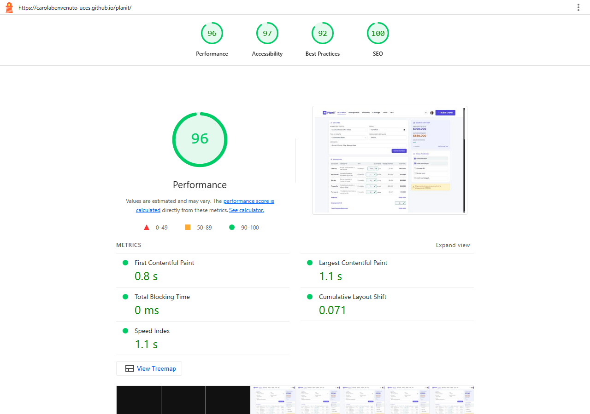
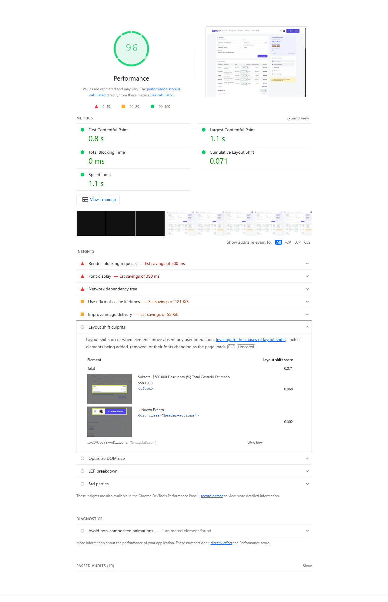
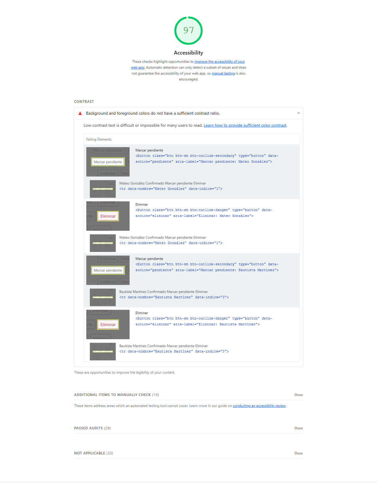
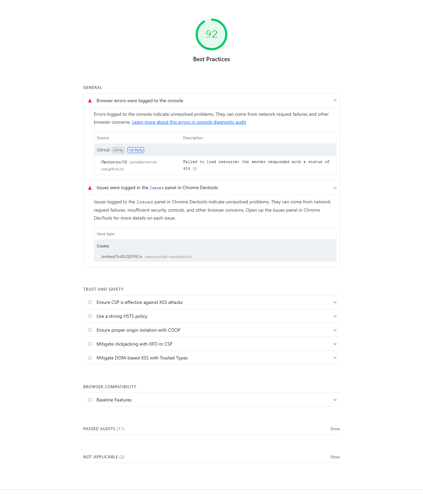
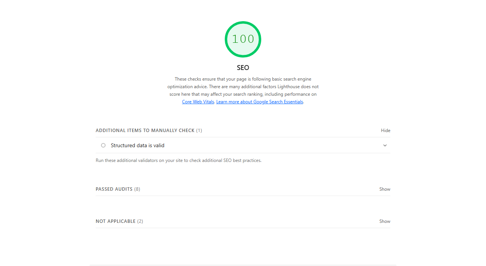

# Test Case 12 (TC12) — Auditoría Lighthouse: Post-fetch

## Objetivo

Medir con Lighthouse el sitio publicado de PlanIT **después del merge de `feature/dev-async-fetch-api`** (PR [#147](https://github.com/carolabenvenuto-uces/planit/pull/147)), que reemplaza el catálogo hardcodeado por una carga asíncrona con `fetch` desde `api/proveedores.json`, y compararlo contra la línea base del [Test Case 11 – Baseline](test-case-11-lighthouse-baseline.md) para detectar regresiones. También verifica las correcciones de las issues del TC11 que se resolvieron en esa PR (#141, #143 y #144). Los resultados de este test case son la referencia del [Test Case 13 – Post-librería](test-case-13-lighthouse-post-library.md), según el plan de la sección 3 de [spec-tester-qa-segundo-parcial.md](../03-specs/segundo-parcial/spec-tester-qa-segundo-parcial.md).

---

## 1. Información general

| Campo | Valor |
|---|---|
| **Issue principal** | [#139](https://github.com/carolabenvenuto-uces/planit/issues/139) |
| **Responsable** | Valeria Silva (@ValeriaMSilva), Tester QA/JS |
| **Fecha de ejecución** | 26/11/2026, entre las 12:41 y las 12:42 (UTC−3) |
| **URL auditada** | [https://carolabenvenuto-uces.github.io/planit/](https://carolabenvenuto-uces.github.io/planit/) (`finalDisplayedUrl` idéntica en las 3 corridas) |
| **Rama publicada** | `develop` @ `6aae3d8` (merge de la PR #147, `feature/dev-async-fetch-api`) |
| **Verificación del despliegue** | El hash SHA-256 de `index.html`, `js/script.js`, `js/api/apiService.js` y `api/proveedores.json` servidos por GitHub Pages coincide byte a byte con el de `origin/develop` @ `6aae3d8`. Los cuatro recursos respondieron HTTP 200; `api/proveedores.json` tiene `version: 1` y 3 proveedores. |
| **Navegador** | Google Chrome 158.0.8127.38 (headless, perfil de incógnito) |
| **Lighthouse** | 13.6.0 (CLI, mediante `npx`; misma versión que el TC11) |
| **Modo** | Desktop (`--preset=desktop`): pantalla emulada de 1350 px de ancho, limitación simulada de red (RTT 40 ms, 10 Mbps) y sin limitación de CPU |
| **Método** | 3 corridas consecutivas con Lighthouse CLI; se informa la mediana de cada categoría y de cada métrica |
| **Corrida mediana** | Corrida 3 (su puntaje de Performance, 96, coincide con la mediana) |
| **Resultado** | ❌ **NO PASA en Best Practices – sin regresión** (Best Practices 92 contra un umbral de 95; ninguna regresión respecto del TC11; ver sección 7) |

### Comando ejecutado

Se ejecutó tres veces, cambiando solo el sufijo de `--output-path`:

```text
npx --yes lighthouse@13.6.0 https://carolabenvenuto-uces.github.io/planit/ \
  --preset=desktop \
  --only-categories=performance,accessibility,best-practices,seo \
  --output=html --output=json \
  --output-path=lighthouse-post-fetch-run-N \
  --chrome-flags="--headless=new --incognito" --quiet
```

Respecto del TC11 hay dos diferencias en la invocación, ninguna en las condiciones de medición: la versión de Lighthouse se fijó explícitamente en `13.6.0` (en el TC11, `@latest` resolvió a esa misma versión) y Chrome se abrió en modo incógnito para asegurar un perfil limpio, como pide la sección 3.2 del spec.

Las capturas se tomaron con Playwright (Chromium, viewport de 1280 × 900) sobre el reporte HTML de la corrida mediana, con el mismo criterio del TC11: en las capturas por categoría se ocultó el encabezado fijo del reporte y se expandieron las auditorías fallidas. En la de Performance se expandió además *Layout shift culprits*, porque el CLS es el riesgo específico del momento post-fetch (sección 3.3 del spec).

---

## 2. Umbrales de aceptación

Se mantienen los del TC11. El criterio de **regresión** es el de la sección 3.3 del spec: una caída de 5 puntos o más en cualquier categoría, o un empeoramiento de LCP, TBT o CLS que cambie su calificación en Lighthouse.

| Categoría | Umbral |
|---|---|
| Performance | ≥ 95 |
| Accessibility | ≥ 95 |
| Best Practices | ≥ 95 |
| SEO | ≥ 95 |

---

## 3. Resultados

### 3.1. Puntajes por categoría (mediana de 3 corridas)

| Categoría | Mediana | TC11 | Δ | Umbral | Resultado |
|---|---|---|---|---|---|
| Performance | **96** | 95 | +1 | ≥ 95 | ✅ Cumple |
| Accessibility | **97** | 97 | 0 | ≥ 95 | ✅ Cumple |
| Best Practices | **92** | 92 | 0 | ≥ 95 | ❌ No cumple (sin cambios respecto del TC11) |
| SEO | **100** | 91 | **+9** | ≥ 95 | ✅ Cumple (antes no cumplía) |

### 3.2. Métricas de rendimiento (mediana de 3 corridas)

La valoración corresponde a la que asigna Lighthouse en modo Desktop (verde = buena, naranja = necesita mejoras).

| Métrica | Mediana | TC11 | Valoración | Valoración en el TC11 |
|---|---|---|---|---|
| First Contentful Paint (FCP) | 0,80 s | 0,89 s | 🟢 Buena | 🟢 Buena |
| Largest Contentful Paint (LCP) | 1,14 s | 0,96 s | 🟢 Buena (en el límite) | 🟢 Buena |
| Total Blocking Time (TBT) | 0 ms | 0 ms | 🟢 Buena | 🟢 Buena |
| Cumulative Layout Shift (CLS) | 0,071 | 0,071 | 🟢 Buena | 🟢 Buena |
| Speed Index (SI) | 1,07 s | 1,42 s | 🟢 Buena | 🟠 Necesita mejoras |

> En esta auditoría las cinco medianas provienen de la corrida 3, porque en todas las métricas su valor quedó entre el de la corrida 1 y el de la corrida 2. El reporte de la corrida mediana redondea a un decimal (FCP 0,8 s, LCP 1,1 s, SI 1,1 s).

### 3.3. Detalle de las 3 corridas

| Corrida | Hora (UTC−3) | Perf. | Acc. | BP | SEO | FCP | LCP | TBT | CLS | SI |
|---|---|---|---|---|---|---|---|---|---|---|
| 1 | 12:41:59 | 95 | 97 | 92 | 100 | 0,83 s | 1,21 s 🟠 | 0 ms | 0,071 | 1,17 s |
| 2 | 12:42:20 | 99 | 97 | 92 | 100 | 0,59 s | 0,68 s | 0 ms | 0,071 | 0,62 s |
| **3 (mediana)** | 12:42:38 | **96** | 97 | 92 | 100 | 0,80 s | 1,14 s | 0 ms | 0,071 | 1,07 s |
| **Mediana** | — | **96** | **97** | **92** | **100** | **0,80 s** | **1,14 s** | **0 ms** | **0,071** | **1,07 s** |

La hora es el `fetchTime` de cada reporte JSON. Igual que en el TC11, Accessibility, Best Practices, SEO, TBT y CLS dieron el mismo valor en las tres corridas, y la variación se concentra en Performance (95 a 99) y en las métricas de tiempo de carga. En la corrida 1, el LCP (1,21 s) obtuvo un puntaje de 0,89 y quedó en naranja; en la corrida 3 (1,14 s) el puntaje es 0,91.

### 3.4. Comparación con el TC11 y regresión

| Criterio (spec, sección 3.3) | TC11 → TC12 | ¿Regresión? |
|---|---|---|
| Caída de 5 puntos o más en alguna categoría | Performance +1, Accessibility 0, Best Practices 0, SEO +9 | No |
| LCP cambia de calificación | 0,96 s → 1,14 s, ambas 🟢 | No (empeora 0,18 s, sin cambiar de calificación) |
| TBT cambia de calificación | 0 ms → 0 ms | No |
| CLS cambia de calificación | 0,071 → 0,071 | No |

**No se detecta regresión.** Además, se verifican las tres correcciones de la PR #147 sobre hallazgos del TC11:

| Issue del TC11 | Verificación en el TC12 | Estado |
|---|---|---|
| [#141](https://github.com/carolabenvenuto-uces/planit/issues/141) (S1, meta description) | Auditoría `meta-description` aprobada; SEO pasa de 91 a **100**. | ✅ Verificada |
| [#143](https://github.com/carolabenvenuto-uces/planit/issues/143) (P1, imágenes del catálogo) | Las tarjetas usan las versiones `catalogo-*-450w.jpg` (20–25 KiB cada una). El ahorro estimado de *Improve image delivery* baja de 485 KiB a 55 KiB y el peso total de la página, de 1731 KiB a **1305 KiB**. | ✅ Verificada |
| [#144](https://github.com/carolabenvenuto-uces/planit/issues/144) (A2, nombre accesible de "Sumar al Evento") | Auditoría `label-content-name-mismatch` aprobada (en el TC11 fallaba). | ✅ Verificada |

---

## 4. Capturas de evidencia

Reportes completos de la corrida mediana: [lighthouse-post-fetch-report.html](screenshots/lighthouse-post-fetch-report.html) · [lighthouse-post-fetch-report.json](screenshots/lighthouse-post-fetch-report.json)

### Resumen



### Performance



### Accessibility



### Best Practices



### SEO



---

## 5. Problemas encontrados

### 5.1. Performance (96 · cumple)

| # | Hallazgo | Detalle | Impacto | Issue |
|---|---|---|---|---|
| P1 | **LCP en "buena", pero cerca del límite** | El LCP sube de 0,96 s (TC11) a 1,14 s y su puntaje queda en 0,91; la corrida 1 (1,21 s, puntaje 0,89) ya quedó en naranja. El elemento LCP es el mismo que en el TC11, `span#resumen-alerta-texto` (barra lateral del presupuesto), no la sección Catálogo. En la corrida 3, el desglose del LCP es 372 ms de *Time to first byte* y 783 ms de *Element render delay*. | Medio: no es regresión según el criterio del spec, pero cualquier recurso nuevo que bloquee el renderizado puede pasarlo a "necesita mejoras". **Se vuelve a medir en el TC13**, con la librería externa integrada. | Sin issue (observación; se vigila en el TC13) |
| P2 | **Desplazamiento de diseño (CLS 0,071)** | Igual que en el TC11. *Layout shift culprits* atribuye 0,068 al `<tfoot>` de la tabla de presupuesto (`form#form-presupuesto > div.table-wrapper > table.data-table > tfoot`) y 0,002 a `div.header-actions` del encabezado (con una fuente web como causa). En `index.html`, el `<tbody id="desglose-presupuesto">` está vacío y sus filas las genera `renderFilasPresupuesto()` después del primer renderizado, lo que desplaza el `<tfoot>`. **El catálogo cargado con `fetch` no aporta desplazamientos**: la altura mínima del estado de carga de la PR #147 cumple su objetivo. | Bajo: dentro del rango "bueno" (< 0,1), pero cerca del límite. | Pendiente (borrador de issue nueva) |
| P3 | Cadena de CSS que bloquea el renderizado | Sigue el `@import` de Google Fonts en `css/styles.css` (línea 14). En la corrida 3, *Render-blocking requests* estima 500 ms de ahorro (en el TC11, 270 ms); *Font display* estima 390 ms por la fuente Roboto del iframe de YouTube. | Medio: es el principal riesgo para el LCP (P1). | [#145](https://github.com/carolabenvenuto-uces/planit/issues/145) |
| P4 | Imágenes del catálogo | Resuelto en lo principal (#143). Queda un ahorro estimado de 55 KiB, porque las imágenes de 450 px se muestran a 216 × 105 px. | Muy bajo. | Sin issue |
| P5 | Tiempo de caché corto | GitHub Pages sirve los recursos propios con `Cache-Control` de 10 minutos (ahorro estimado: 121 KiB en visitas repetidas; en el TC11, 513 KiB, antes de reducir las imágenes). | Bajo. No es configurable desde el repositorio en GitHub Pages. | Sin issue (limitación de la plataforma) |

### 5.2. Accessibility (97 · cumple)

| # | Hallazgo | Detalle | Impacto | Issue |
|---|---|---|---|---|
| A1 | **Contraste insuficiente en los botones de la tabla de invitados** | Sin cambios respecto del TC11: "Marcar pendiente" (#6c757d sobre #fafafa, 4,49:1) y "Eliminar" (#dc3545 sobre #fafafa, 4,33:1), en las filas de los invitados confirmados (Mateo González y Bautista Martínez). Mínimo WCAG 2.1 AA (1.4.3): 4,5:1. | Es la única auditoría con peso que falla en la categoría (`color-contrast`). | [#140](https://github.com/carolabenvenuto-uces/planit/issues/140) |

### 5.3. Best Practices (92 · no cumple)

| # | Hallazgo | Detalle | Impacto | Issue |
|---|---|---|---|---|
| B1 | **Error 404 en la consola por `favicon.ico`** | Sin cambios: el navegador pide `https://carolabenvenuto-uces.github.io/favicon.ico` (raíz del dominio) y recibe 404. | Hace fallar `errors-in-console`. | [#142](https://github.com/carolabenvenuto-uces/planit/issues/142) |
| B2 | Aviso de cookies en el panel *Issues* | Sin cambios: lo genera el iframe de `www.youtube-nocookie.com/embed/5vi0UQDYNCw`. | Hace fallar `inspector-issues`. Proviene de un tercero. | [#156](https://github.com/carolabenvenuto-uces/planit/issues/156) |

> Best Practices obtiene exactamente el mismo puntaje que en el TC11 (92) por los mismos dos motivos. La PR #147 no agrega errores de consola: la carga del catálogo con `fetch` no generó ningún error en las tres corridas.
>
> **Cálculo del puntaje** (reporte JSON de la corrida mediana): la categoría promedia 26 auditorías con peso 1 y fallan 2, `errors-in-console` (B1) e `inspector-issues` (B2): 24/26 = 0,92. Corregir cualquiera de las dos deja 25/26 ≈ 0,96, por encima del umbral de 95; corregir las dos, 100.

### 5.4. SEO (100 · cumple)

Sin auditorías fallidas. La meta description agregada en la PR #147 (#141) resuelve el único hallazgo del TC11.

---

## 6. Issues relacionadas

| Issue | Título | Categoría | Estado tras el TC12 | Rol responsable |
|---|---|---|---|---|
| [#140](https://github.com/carolabenvenuto-uces/planit/issues/140) | [A11y] Contraste insuficiente en botones "Marcar pendiente" y "Eliminar" de la tabla de invitados | Accessibility | Sigue abierta: la auditoría falla igual que en el TC11. | Desarrollador/a JS Librerías Externas |
| [#141](https://github.com/carolabenvenuto-uces/planit/issues/141) | [SEO] Agregar meta description a index.html | SEO | Verificada: SEO 100. Puede cerrarse. | Desarrolladora JS Asíncrono |
| [#142](https://github.com/carolabenvenuto-uces/planit/issues/142) | [Best Practices] Error 404 en consola por falta de favicon | Best Practices | Sigue abierta: el 404 persiste. | Desarrollador/a JS Librerías Externas |
| [#143](https://github.com/carolabenvenuto-uces/planit/issues/143) | [Performance] Imágenes del catálogo sobredimensionadas (485 KiB de ahorro estimado) | Performance | Verificada: 1305 KiB totales, ahorro residual de 55 KiB y Performance 96. Puede cerrarse. | Desarrolladora JS Asíncrono |
| [#144](https://github.com/carolabenvenuto-uces/planit/issues/144) | [A11y] El nombre accesible de "Sumar al Evento" no incluye el texto visible | Accessibility | Verificada: `label-content-name-mismatch` aprobada. Puede cerrarse. | Desarrolladora JS Asíncrono |
| [#145](https://github.com/carolabenvenuto-uces/planit/issues/145) | [Performance] Cadena de CSS que bloquea el renderizado (@import de Google Fonts) | Performance | Sigue abierta: el `@import` persiste y es el principal riesgo para el LCP. | Desarrollador/a JS Librerías Externas |
| [#150](https://github.com/carolabenvenuto-uces/planit/issues/150) | [Dev Eventos+DOM] CLS de 0,068 por el tfoot de la tabla de presupuesto | Performance | Abierta (hallazgo P2). Creada después de este test case. | Dev Eventos+DOM |
| [#156](https://github.com/carolabenvenuto-uces/planit/issues/156) | [Best Practices] Aviso de cookies del iframe de YouTube en el panel Issues | Best Practices | Abierta (hallazgo B2). Creada en la review de la PR #152. | Desarrollador/a JS Librerías Externas |

---

## 7. Conclusiones

1. **Veredicto: NO PASA en Best Practices – sin regresión.** El sitio con el catálogo asíncrono obtiene medianas de **96 / 97 / 92 / 100** (Performance / Accessibility / Best Practices / SEO) en modo Desktop. Performance, Accessibility y SEO alcanzan el umbral de 95 (sección 2); **Best Practices (92) no lo alcanza**, por el 404 de `favicon.ico` (#142) y el aviso de cookies del iframe de YouTube ([#156](https://github.com/carolabenvenuto-uces/planit/issues/156)). Ninguna categoría cae 5 puntos o más y LCP, TBT y CLS mantienen su calificación, así que **no hay regresión** respecto del TC11: Best Practices ya estaba en 92 en la línea base y la PR #147 no lo empeora. Estos valores son la referencia para el TC13.
2. **Mejoras verificadas:** SEO sube de 91 a 100 (#141); el peso de la página baja de 1731 KiB a 1305 KiB y el Speed Index pasa de 1,42 s ("necesita mejoras") a 1,07 s ("buena") (#143); y el nombre accesible de "Sumar al Evento" ya cumple WCAG 2.5.3 (#144).
3. **Observaciones:**
   - **Best Practices 92, igual que en el TC11:** el 404 de `favicon.ico` en la raíz del dominio (#142) y el aviso de cookies del iframe de YouTube ([#156](https://github.com/carolabenvenuto-uces/planit/issues/156)). Cada una resta una de las 26 auditorías con peso: corregir cualquiera de las dos lleva la categoría a 96 y corregir ambas, a 100 (sección 5.3).
   - **LCP en "buena", pero cerca del límite:** 1,14 s de mediana, con una corrida en naranja (1,21 s). El elemento LCP no es el catálogo sino el texto de la alerta del resumen de presupuesto. **Se vuelve a medir en el TC13**, donde el riesgo principal es que la librería externa sume recursos a la cadena de bloqueo de #145.
   - **El CLS (0,071) no proviene del catálogo:** 0,068 lo produce el `<tfoot>` de la tabla de presupuesto y 0,002 `header-actions`. La altura mínima del estado de carga evitó que la carga asíncrona sumara desplazamientos, que era el riesgo post-fetch previsto en el spec.
   - **Accessibility 97 con `color-contrast`** fallando en los mismos botones que en el TC11 (#140).
4. **Limitaciones de la medición:** se usó el mismo comando, el mismo modo y la misma URL que en el TC11, pero con Chrome 158 (en el TC11 fue Chrome 157): la versión del navegador cambió entre ambas auditorías. Los puntajes de Performance dependen de la red y de la carga de la máquina en el momento de la corrida, por eso se informa la mediana de tres corridas.
