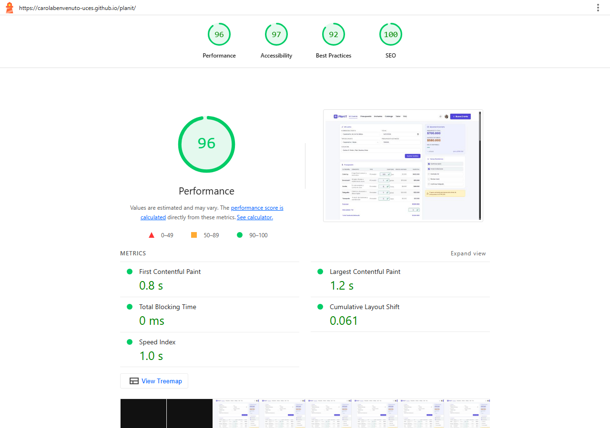
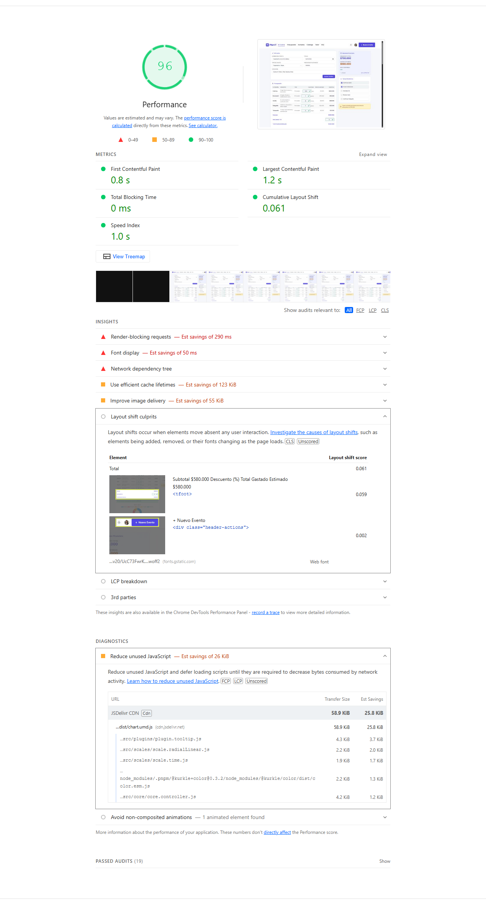
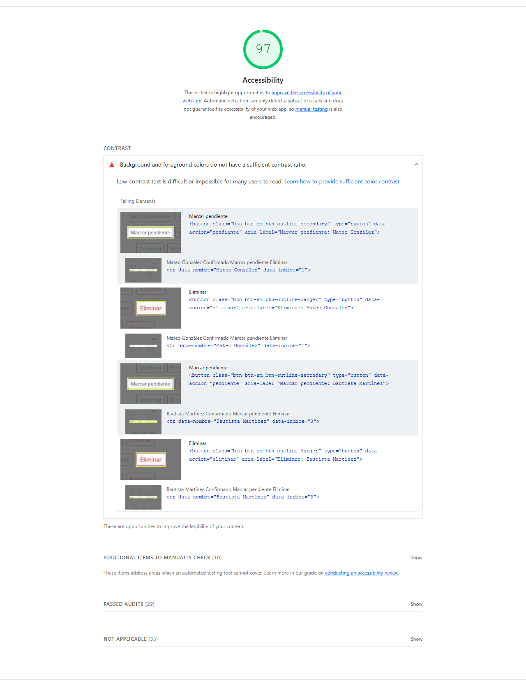
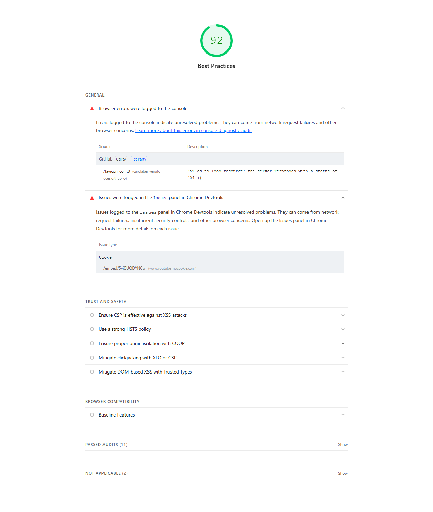
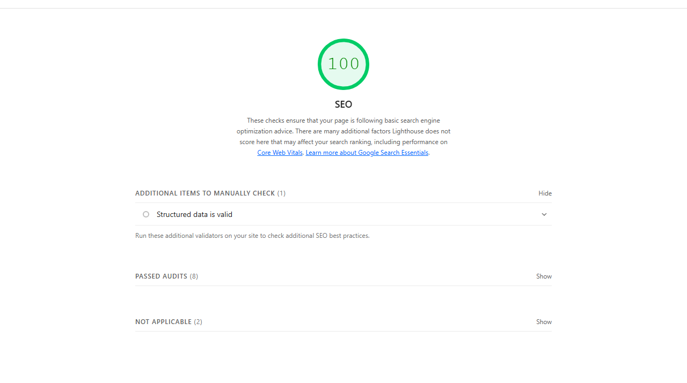

# Test Case 13 (TC13) — Auditoría Lighthouse: Post-librería

## Objetivo

Medir con Lighthouse el sitio publicado de PlanIT **después del merge de `feature/dev-libreria-externa-chartjs`** (PR [#149](https://github.com/carolabenvenuto-uces/planit/pull/149)). Esa PR integra **Chart.js 4.4.7** desde jsDelivr, mediante el wrapper `GraficoService` (`js/charts/graficoService.js`), con dos gráficos: la dona de gasto por categoría (Presupuesto) y las barras de proveedores por categoría (Catálogo). El resultado se compara contra el [Test Case 12 – Post-fetch](test-case-12-lighthouse-post-fetch.md) para detectar regresiones, según el plan de la sección 3 de [spec-tester-qa-segundo-parcial.md](../03-specs/segundo-parcial/spec-tester-qa-segundo-parcial.md). Es la última auditoría del parcial: refleja el sitio con todas las features integradas.

---

## 1. Información general

| Campo | Valor |
|---|---|
| **Issue principal** | [#139](https://github.com/carolabenvenuto-uces/planit/issues/139) |
| **Responsable** | Valeria Silva (@ValeriaMSilva), Tester QA/JS |
| **Fecha de ejecución** | 27/11/2026, entre las 20:02 y las 20:03 (UTC−3) |
| **URL auditada** | [https://carolabenvenuto-uces.github.io/planit/](https://carolabenvenuto-uces.github.io/planit/) (`finalDisplayedUrl` idéntica en las 3 corridas) |
| **Rama publicada** | `develop` @ `c8d7338` (merge de la PR #149, `feature/dev-libreria-externa-chartjs`) |
| **Verificación del despliegue** | `git ls-remote` confirma que `origin/develop` está en `c8d7338`. El hash SHA-256 de `index.html`, `js/script.js`, `js/charts/graficoService.js` y `api/proveedores.json` servidos por GitHub Pages coincide byte a byte con el de `origin/develop` @ `c8d7338`. `api/proveedores.json` respondió HTTP 200. Pages informó `Last-Modified: 27/11/2026 19:43:16 (UTC−3)`, posterior al commit de merge (19:42:39). |
| **Navegador** | Google Chrome 158.0.8127.38 (headless, perfil de incógnito), la misma versión que en el TC12 |
| **Lighthouse** | 13.6.0 (CLI, mediante `npx`; la misma versión que en el TC11 y el TC12) |
| **Modo** | Desktop (`--preset=desktop`): pantalla emulada de 1350 px de ancho, limitación simulada de red (RTT 40 ms, 10 Mbps) y sin limitación de CPU |
| **Método** | 3 corridas consecutivas con Lighthouse CLI; se informa la mediana de cada categoría y de cada métrica |
| **Corrida mediana** | Corrida 3 (ver la nota de la sección 3.3) |
| **Resultado** | ✅ **PASA CON OBSERVACIONES** (sin regresión respecto del TC12; ver sección 7) |

### Comando ejecutado

Se ejecutó tres veces, cambiando solo el sufijo de `--output-path`. Es la misma invocación del TC12:

```text
npx --yes lighthouse@13.6.0 https://carolabenvenuto-uces.github.io/planit/ \
  --preset=desktop \
  --only-categories=performance,accessibility,best-practices,seo \
  --output=html --output=json \
  --output-path=lighthouse-post-library-run-N \
  --chrome-flags="--headless=new --incognito" --quiet
```

Las capturas se tomaron con Playwright (Chromium, viewport de 1280 × 900) sobre el reporte HTML de la corrida mediana, con el mismo criterio del TC11 y el TC12: en las capturas por categoría se ocultó el encabezado fijo del reporte y se expandieron las auditorías fallidas. En Performance se expandieron solo *Layout shift culprits* y *Reduce unused JavaScript*, porque el peso de la librería y el CLS son los riesgos del momento post-librería (sección 3.3 del spec).

---

## 2. Umbrales de aceptación

Se mantienen los del TC11 y el TC12. El criterio de **regresión** es el de la sección 3.3 del spec: una caída de 5 puntos o más en cualquier categoría, o un empeoramiento de LCP, TBT o CLS que cambie su calificación en Lighthouse.

| Categoría | Umbral |
|---|---|
| Performance | ≥ 95 |
| Accessibility | ≥ 95 |
| Best Practices | ≥ 95 |
| SEO | ≥ 95 |

---

## 3. Resultados

### 3.1. Puntajes por categoría (mediana de 3 corridas)

| Categoría | Mediana | TC12 | Δ | TC11 | Umbral | Resultado |
|---|---|---|---|---|---|---|
| Performance | **96** | 96 | 0 | 95 | ≥ 95 | ✅ Cumple |
| Accessibility | **97** | 97 | 0 | 97 | ≥ 95 | ✅ Cumple |
| Best Practices | **92** | 92 | 0 | 92 | ≥ 95 | ❌ No cumple (sin cambios desde el TC11) |
| SEO | **100** | 100 | 0 | 91 | ≥ 95 | ✅ Cumple |

### 3.2. Métricas de rendimiento (mediana de 3 corridas)

La valoración es la que asigna Lighthouse en modo Desktop (verde = buena, naranja = necesita mejoras).

| Métrica | Mediana | TC12 | Δ | Valoración | Valoración en el TC12 |
|---|---|---|---|---|---|
| First Contentful Paint (FCP) | 0,84 s | 0,80 s | +0,04 s | 🟢 Buena | 🟢 Buena |
| Largest Contentful Paint (LCP) | 1,15 s | 1,14 s | +0,01 s | 🟢 Buena (en el límite) | 🟢 Buena (en el límite) |
| Total Blocking Time (TBT) | 0 ms | 0 ms | 0 | 🟢 Buena | 🟢 Buena |
| Cumulative Layout Shift (CLS) | 0,061 | 0,071 | −0,010 | 🟢 Buena | 🟢 Buena |
| Speed Index (SI) | 0,98 s | 1,07 s | −0,09 s | 🟢 Buena | 🟢 Buena |

> El reporte de la corrida mediana redondea a un decimal (FCP 0,8 s, LCP 1,2 s, SI 1,0 s). La mediana del LCP (1,15 s) corresponde a la corrida 1; las de FCP, CLS y SI, a la corrida 3.

### 3.3. Detalle de las 3 corridas

| Corrida | Hora (UTC−3) | Perf. | Acc. | BP | SEO | FCP | LCP | TBT | CLS | SI |
|---|---|---|---|---|---|---|---|---|---|---|
| 1 | 20:02:40 | 96 | 97 | 92 | 100 | 0,85 s | 1,15 s | 0 ms | 0,065 | 1,02 s |
| 2 | 20:02:55 | 98 | 97 | 92 | 100 | 0,56 s | 0,99 s | 0 ms | 0,061 | 0,66 s |
| **3 (mediana)** | 20:03:11 | **96** | 97 | 92 | 100 | 0,84 s | 1,18 s | 0 ms | 0,061 | 0,98 s |
| **Mediana** | — | **96** | **97** | **92** | **100** | **0,84 s** | **1,15 s** | **0 ms** | **0,061** | **0,98 s** |

La hora es el `fetchTime` de cada reporte JSON. Igual que en el TC11 y el TC12, Accessibility, Best Practices, SEO y TBT dieron el mismo valor en las tres corridas, y la variación se concentra en Performance (96 a 98) y en los tiempos de carga.

**Elección de la corrida mediana.** Dos corridas (la 1 y la 3) tienen el puntaje de Performance de la mediana (96). Se tomó la **corrida 3** porque además coincide con la mediana de FCP, CLS y SI; la corrida 1 solo coincide con la de LCP. El LCP de la corrida 3 (1,18 s) tiene un puntaje de 0,90, el mínimo de la calificación "buena"; ninguna de las tres corridas quedó en naranja (en el TC12, la corrida 1 sí, con 1,21 s).

### 3.4. Comparación con el TC12 y regresión

| Criterio (spec, sección 3.3) | TC12 → TC13 | ¿Regresión? |
|---|---|---|
| Caída de 5 puntos o más en alguna categoría | Performance 0, Accessibility 0, Best Practices 0, SEO 0 | No |
| LCP cambia de calificación | 1,14 s → 1,15 s, ambas 🟢 | No (+0,01 s) |
| TBT cambia de calificación | 0 ms → 0 ms | No |
| CLS cambia de calificación | 0,071 → **0,061**, ambas 🟢 | No (mejora 0,010) |

Contra la línea base (TC11: 95 / 97 / 92 / 91; LCP 0,96 s, TBT 0 ms, CLS 0,071) tampoco hay regresión: ninguna categoría baja y el LCP sigue en "buena" (+0,19 s acumulados en el parcial).

**No se detecta regresión.**

### 3.5. Costo de Chart.js

Datos de la corrida mediana (corrida 3), salvo que se indique otra cosa. Las únicas requests nuevas respecto del TC12 que no vienen del iframe de YouTube son `chart.umd.js` y `graficoService.js`.

| Aspecto | Medición | Comentario |
|---|---|---|
| **Bytes de Chart.js** | `chart.umd.js`: **60.447 B transferidos (59,0 KiB)**; 205.615 B sin comprimir. `graficoService.js`: 719 B transferidos. | El mismo tamaño en las 3 corridas. |
| **Peso total de la página** | 1.336.264 B (1305 KiB) en el TC12 → **1.400.003 B (1367 KiB)**: +63.739 B (+62,2 KiB) | Chart.js y `graficoService.js` explican 61.166 B (el 96 %) de la diferencia; el resto corresponde a variaciones de otros recursos. Requests: 44 → 47. |
| **Tiempo de descarga** | 78 ms (corrida 3); 93 y 92 ms en las corridas 1 y 2 | Se descarga en paralelo con los scripts propios, con prioridad *Low* (`defer`). No figura en *Render-blocking requests*, que solo lista CSS. |
| **Tiempo de CPU** | *JavaScript execution time* de `chart.umd.js`: 190 ms (108 ms de ejecución); 179 y 216 ms en las corridas 1 y 2 | Es el script con más tiempo de CPU de la página. El trabajo total del hilo principal sube de 342 ms (TC12) a 443 ms, pero **el TBT sigue en 0 ms** en las 3 corridas: no genera tareas largas que bloqueen la interacción. |
| **JavaScript sin usar** | *Reduce unused JavaScript*: 25,8 KiB de los 58,9 KiB de `chart.umd.js` (corrida 3) | Solo aparece en la corrida 3; en las corridas 1 y 2 la auditoría aprueba. El build UMD incluye todos los tipos de gráfico, escalas y plugins (tooltip, escala radial, escala de tiempo), aunque la app usa solo dona y barras. No tiene peso en el puntaje. |
| **Terceros** | jsDelivr: 104.934 B (Bootstrap CSS y JS más Chart.js) | En el TC12 jsDelivr servía solo Bootstrap. |
| **Impacto en LCP y CLS** | Ninguno observable | El elemento LCP no es un gráfico (sección 5.1, P1). Los canvas tienen alto fijo (`[data-grafico-contenedor]`, PR #149, B1) y no aparecen en *Layout shift culprits*. |

---

## 4. Capturas de evidencia

Reportes completos de la corrida mediana: [lighthouse-post-library-report.html](screenshots/lighthouse-post-library-report.html) · [lighthouse-post-library-report.json](screenshots/lighthouse-post-library-report.json)

### Resumen



### Performance



### Accessibility



### Best Practices



### SEO



---

## 5. Problemas encontrados

### 5.1. Performance (96 · cumple)

| # | Hallazgo | Detalle | Impacto | Issue |
|---|---|---|---|---|
| P1 | **LCP en "buena", pero en el límite** | La mediana del LCP es 1,15 s (TC12: 1,14 s); la corrida mediana (1,18 s) tiene un puntaje de 0,90, el mínimo de "buena". El elemento LCP es el mismo que en el TC11 y el TC12, `span#resumen-alerta-texto` (barra lateral del presupuesto). En la corrida 3, el desglose es 336 ms de *Time to first byte* y 525 ms de *Element render delay*. Chart.js no está en ese camino: se carga con `defer` y prioridad *Low*, y no aparece entre los recursos que bloquean el renderizado. | Medio: la librería no lo empeoró de forma apreciable (+0,01 s), pero el margen sigue siendo mínimo. El principal riesgo sigue siendo la cadena de CSS de #145. | [#145](https://github.com/carolabenvenuto-uces/planit/issues/145) (causa principal); sin issue propia |
| P2 | **Desplazamiento de diseño (CLS 0,061)** | Baja de 0,071 a 0,061. *Layout shift culprits* atribuye 0,059 al `<tfoot>` de la tabla de presupuesto (`form#form-presupuesto > div.table-wrapper > table.data-table > tfoot`) y 0,002 a `div.header-actions` del encabezado (por la fuente web Inter). En la corrida 1, el único culpable es el `<tfoot>` (0,065). **Los gráficos no aportan desplazamientos**: el alto fijo de los contenedores de la PR #149 (B1) cumple su objetivo. | Bajo: dentro del rango "bueno" (< 0,1). | [#150](https://github.com/carolabenvenuto-uces/planit/issues/150) |
| P3 | Cadena de CSS que bloquea el renderizado | *Render-blocking requests* estima 290 ms de ahorro (TC12: 500 ms): `@import` de Google Fonts (320 ms) y `bootstrap.min.css` (300 ms). *Font display* estima 50 ms (TC12: 390 ms). | Medio: es el principal riesgo para el LCP (P1). | [#145](https://github.com/carolabenvenuto-uces/planit/issues/145) |
| P4 | **JavaScript sin usar en Chart.js** (nuevo) | 25,8 KiB de 58,9 KiB de `chart.umd.js` sin usar, solo en la corrida 3 (sección 3.5). Reducirlo requiere registrar solo los componentes usados (`DoughnutController`, `BarController`, etc.) desde el build ESM, lo que implica un *bundler*; la PR #149 eligió el build UMD por CDN a propósito, sin *bundler* (spec-dev-libreria-externa.md, sección 2). | Muy bajo: la auditoría no tiene peso en el puntaje y el TBT sigue en 0 ms. | Sin issue (observación; decisión de diseño documentada) |
| P5 | Imágenes del catálogo y caché | Igual que en el TC12: ahorro estimado de 55 KiB en imágenes y 123 KiB de caché en visitas repetidas (`Cache-Control` de 10 minutos de GitHub Pages). | Muy bajo. La caché no es configurable desde el repositorio. | Sin issue |
| P6 | Animación no compuesta | *Avoid non-composited animations* marca `input#descuento-presupuesto` (transición de `border-*-color`), igual que en el TC12. No tiene relación con Chart.js. | Muy bajo (sin peso en el puntaje). | Sin issue |

### 5.2. Accessibility (97 · cumple)

| # | Hallazgo | Detalle | Impacto | Issue |
|---|---|---|---|---|
| A1 | **Contraste insuficiente en los botones de la tabla de invitados** | Sin cambios respecto del TC12: "Marcar pendiente" (#6c757d sobre #fafafa, 4,49:1) y "Eliminar" (#dc3545 sobre #fafafa, 4,33:1), en las filas de los invitados confirmados. Mínimo WCAG 2.1 AA (1.4.3): 4,5:1. | Es la única auditoría con peso que falla en la categoría (`color-contrast`). | [#140](https://github.com/carolabenvenuto-uces/planit/issues/140) |

> Los gráficos no agregan fallas de accesibilidad: los `<canvas>` tienen `role="img"` y `aria-label`, y el texto o la tabla que los acompaña queda como alternativa textual (PR #149).

### 5.3. Best Practices (92 · no cumple)

| # | Hallazgo | Detalle | Impacto | Issue |
|---|---|---|---|---|
| B1 | **Error 404 en la consola por `favicon.ico`** | Sin cambios: el navegador pide `https://carolabenvenuto-uces.github.io/favicon.ico` (raíz del dominio) y recibe 404. | Hace fallar `errors-in-console`. | [#142](https://github.com/carolabenvenuto-uces/planit/issues/142) |
| B2 | Aviso de cookies en el panel *Issues* | Sin cambios: lo genera el iframe de `www.youtube-nocookie.com/embed/5vi0UQDYNCw`. | Hace fallar `inspector-issues`. Proviene de un tercero. | Sin issue (observación) |

> Best Practices obtiene el mismo puntaje que en el TC11 y el TC12 (92), por los mismos dos motivos. **Chart.js no agrega errores de consola** en ninguna de las tres corridas: el único error es el 404 del favicon.

### 5.4. SEO (100 · cumple)

Sin auditorías fallidas.

---

## 6. Issues relacionadas

| Issue | Título | Categoría | Estado tras el TC13 | Rol responsable |
|---|---|---|---|---|
| [#140](https://github.com/carolabenvenuto-uces/planit/issues/140) | [A11y] Contraste insuficiente en botones "Marcar pendiente" y "Eliminar" de la tabla de invitados | Accessibility | Sigue abierta: la auditoría falla igual que en el TC12. | Desarrollador/a JS Librerías Externas |
| [#142](https://github.com/carolabenvenuto-uces/planit/issues/142) | [Best Practices] Error 404 en consola por falta de favicon | Best Practices | Sigue abierta: el 404 persiste. | Desarrollador/a JS Librerías Externas |
| [#145](https://github.com/carolabenvenuto-uces/planit/issues/145) | [Performance] Cadena de CSS que bloquea el renderizado (@import de Google Fonts) | Performance | Sigue abierta: el `@import` persiste y sigue siendo el principal riesgo para el LCP. | Desarrollador/a JS Librerías Externas |
| [#150](https://github.com/carolabenvenuto-uces/planit/issues/150) | [Dev Eventos+DOM] CLS de 0,068 por el tfoot de la tabla de presupuesto | Performance | Sigue abierta: el `<tfoot>` aporta 0,059 (TC12: 0,068). | Dev Eventos+DOM |

Las issues #141, #143 y #144, verificadas en el TC12, no cambian: SEO sigue en 100, el ahorro en imágenes sigue en 55 KiB y `label-content-name-mismatch` sigue aprobada.

---

## 7. Conclusiones

1. **Veredicto: PASA CON OBSERVACIONES.** Con todas las features del parcial integradas, el sitio obtiene medianas de **96 / 97 / 92 / 100** (Performance / Accessibility / Best Practices / SEO) en modo Desktop, **las mismas que en el TC12**. Ninguna categoría baja y LCP, TBT y CLS mantienen su calificación, así que **no hay regresión** respecto del TC12 ni de la línea base del TC11. No es un PASA sin observaciones porque Best Practices (92) sigue por debajo del umbral de 95 y el LCP sigue en el límite de "buena".
2. **Costo de Chart.js:** suma 59,0 KiB transferidos (el 96 % del aumento de peso de la página, de 1305 a 1367 KiB) y unos 190 ms de CPU, pero se descarga con `defer` y en paralelo, no bloquea el renderizado y no genera tareas largas (TBT 0 ms). El LCP sube solo 0,01 s y el CLS baja de 0,071 a 0,061: el alto fijo de los gráficos evitó los desplazamientos que preveía el spec como riesgo post-librería.
3. **Observaciones:**
   - **Best Practices 92, igual que en el TC11 y el TC12:** el 404 de `favicon.ico` (#142) y el aviso de cookies del iframe de YouTube. Chart.js no agrega errores de consola.
   - **LCP en el límite de "buena":** 1,15 s de mediana, con la corrida mediana en un puntaje de 0,90. El elemento LCP sigue siendo el texto de la alerta del resumen de presupuesto, no un gráfico; la causa principal sigue siendo la cadena de CSS de #145.
   - **JavaScript sin usar en `chart.umd.js`** (25,8 KiB, solo en una corrida): es el costo del build UMD completo por CDN que eligió la PR #149. No tiene peso en el puntaje.
   - **Accessibility 97 con `color-contrast`** fallando en los mismos botones que en el TC11 y el TC12 (#140).
4. **Limitaciones de la medición:** se usó el mismo comando, el mismo modo, la misma URL y la misma versión de Chrome (158.0.8127.38) que en el TC12. El `benchmarkIndex` de la máquina fue 3191,5 (TC12: 2545,5): la carga de la máquina varió entre ambas auditorías. Por eso se informa la mediana de tres corridas, y las diferencias de pocas centésimas en FCP, LCP y SI no se atribuyen a la librería.
