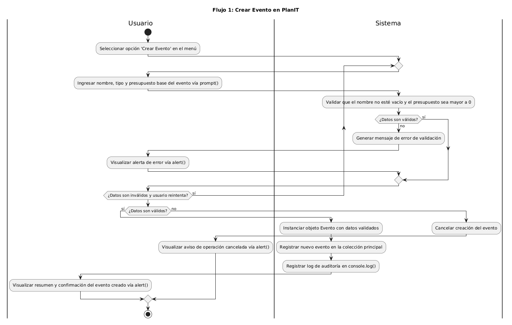
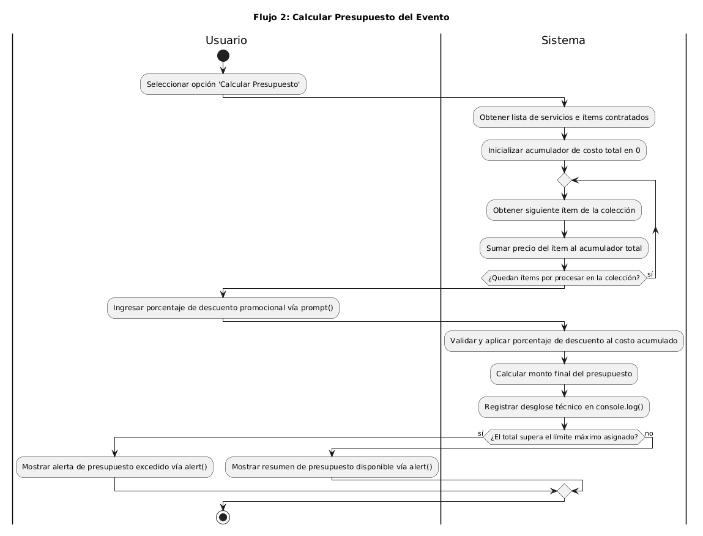
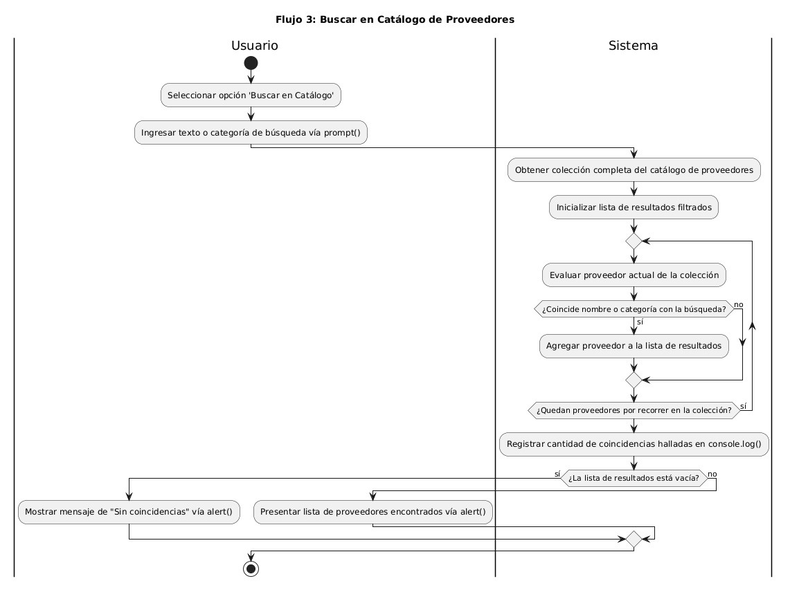
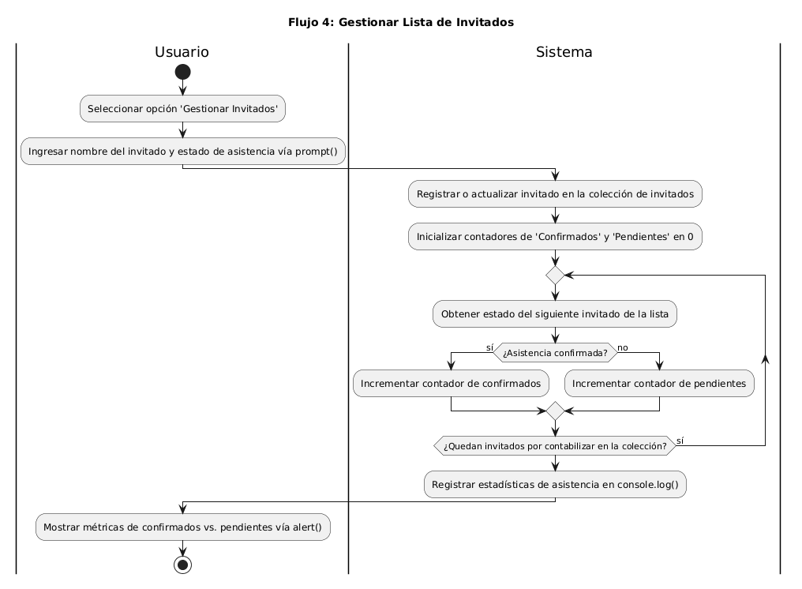

# 📊 Documentación de Diagramas de Actividades (PlanIT - AO3)

## 📌 Índice de Diagramas
1. [Flujo 1: Crear Evento en PlanIT](#flujo-1-crear-evento-en-planit)
2. [Flujo 2: Calcular Presupuesto del Evento](#flujo-2-calcular-presupuesto-del-evento)
3. [Flujo 3: Buscar en Catálogo de Proveedores](#flujo-3-buscar-en-catálogo-de-proveedores)
4. [Flujo 4: Gestionar Lista de Invitados](#flujo-4-gestionar-lista-de-invitados)
5. [Mapeo de Trazabilidad: Flujo ↔ Función ↔ Test Unitario (RC-ARQ-10)](#-mapeo-de-trazabilidad-flujo--función--test-unitario-rc-arq-10)

---

## 🛠️ Instrucciones de Edición y Visualización
Para visualizar o editar los diagramas en PlantUML se pueden emplear las siguientes alternativas:

* **Editor Web Online:** Copiar el contenido del archivo `.puml` editable y pegarlo en PlantUML Editor.
* **Extensión de VS Code:** Instalar la extensión oficial de PlantUML en Visual Studio Code (requiere Java o servidor activo) y presionar `Alt + D` para previsualizar.
* **Exportación:** Generar y actualizar las imágenes en formato `.png` en la misma carpeta.

---

## 📐 Detalle de los Flujos de Negocio

### Flujo 1: Crear Evento en PlanIT
- **Descripción:** Captura los datos iniciales del evento (nombre, tipo y presupuesto base) mediante `prompt()`, valida iterativamente los valores de entrada y cancela o registra la nueva entidad en la colección del sistema.
- **Precondición:** Menú principal de la aplicación activo y listo para seleccionar la opción 'Crear Evento'.
- **Postcondición:** Objeto de evento instanciado y almacenado en la colección principal, o la operación es cancelada por datos inválidos.
- **Entrada Principal:** Nombre del evento, tipo de evento (cumpleaños, boda, salida casual) y presupuesto base ingresados vía `prompt()`.
- **Salida Principal:** Alerta de confirmación/error en pantalla (`alert()`) y registro de auditoría en consola (`console.log()`).
- **Archivo editable:** [`actividad-flujo-1-crear-evento.puml`](./actividad-flujo-1-crear-evento.puml)
- **Diagrama visual:** 

---

### Flujo 2: Calcular Presupuesto del Evento
- **Descripción:** Recorre secuencialmente la colección de servicios contratados mediante un ciclo `while`, valida el porcentaje de descuento ingresado (entre 0 y 100) y calcula el monto total verificando el límite presupuestario.
- **Precondición:** Existencia de una colección de servicios cargados para el evento.
- **Postcondición:** Presupuesto final recalculado con descuento aplicado y advertencia si excede el máximo permitido.
- **Entrada Principal:** Porcentaje de descuento promocional ingresado por el usuario vía `prompt()`.
- **Salida Principal:** Resumen del presupuesto disponible o notificación de sobrepaso vía `alert()`, más desglose técnico en `console.log()`.
- **Archivo editable:** [`actividad-flujo-2-calcular-presupuesto.puml`](./actividad-flujo-2-calcular-presupuesto.puml)
- **Diagrama visual:** 

---

### Flujo 3: Buscar en Catálogo de Proveedores
- **Descripción:** Valida que el criterio de búsqueda no esté vacío y recorre la colección de proveedores mediante un ciclo `while` para filtrar elementos por coincidencia de nombre o categoría.
- **Precondición:** Catálogo con la lista de proveedores e ítems disponibles en memoria.
- **Postcondición:** Arreglo filtrado con los proveedores que coinciden con el término buscado.
- **Entrada Principal:** Cadena de texto o categoría buscada por el usuario vía `prompt()`.
- **Salida Principal:** Presentación de coincidencias o aviso de lista vacía vía `alert()`, con registro del número de hallazgos en `console.log()`.
- **Archivo editable:** [`actividad-flujo-3-buscar-catalogo.puml`](./actividad-flujo-3-buscar-catalogo.puml)
- **Diagrama visual:** 

---

### Flujo 4: Gestionar Lista de Invitados
- **Descripción:** Captura los datos de un invitado, valida su nombre y estado de asistencia, actualiza la lista y recorre la colección completa mediante un ciclo `while` para contabilizar confirmados y pendientes.
- **Precondición:** Menú de gestión de invitados seleccionado.
- **Postcondición:** Colección de invitados actualizada y métricas de asistencia calculadas.
- **Entrada Principal:** Nombre del invitado y estado de confirmación ingresados vía `prompt()`.
- **Salida Principal:** Métricas visuales de confirmados vs. pendientes vía `alert()` y estadísticas detalladas en `console.log()`.
- **Archivo editable:** [`actividad-flujo-4-gestionar-invitados.puml`](./actividad-flujo-4-gestionar-invitados.puml)
- **Diagrama visual:** 

---

## 🔗 Mapeo de Trazabilidad: Flujo ↔ Función ↔ Test Unitario (RC-ARQ-10)

| Flujo de Actividad | Archivo Diagrama | Función Principal (`js/script.js`) | Spec de Prueba (`spec/script.spec.js`) |
| :--- | :--- | :--- | :--- |
| **Flujo 1: Crear Evento** | `actividad-flujo-1-crear-evento.puml` | `crearEvento(nombre, tipo, presupuesto)` | `it("debería crear un evento con datos válidos")` |
| **Flujo 2: Calcular Presupuesto** | `actividad-flujo-2-calcular-presupuesto.puml` | `calcularPresupuesto(descuento)` | `it("debería calcular el presupuesto aplicando el descuento correctamente")` |
| **Flujo 3: Buscar en Catálogo** | `actividad-flujo-3-buscar-catalogo.puml` | `buscarEnCatalogo(criterio)` | `it("debería retornar proveedores que coincidan con la búsqueda")` |
| **Flujo 4: Gestionar Invitados** | `actividad-flujo-4-gestionar-invitados.puml` | `gestionarInvitados(nombre, estado)` | `it("debería contabilizar correctamente confirmados y pendientes")` |