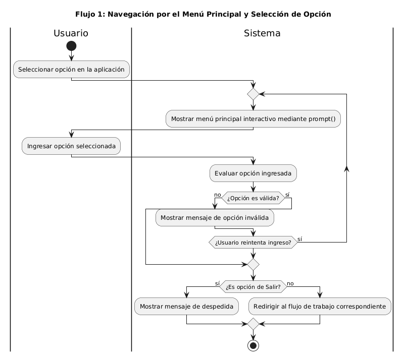
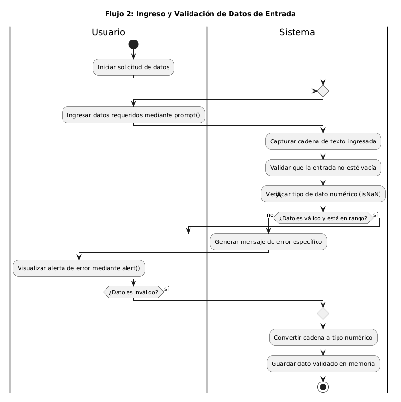
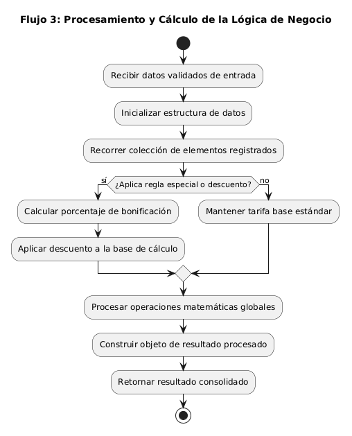
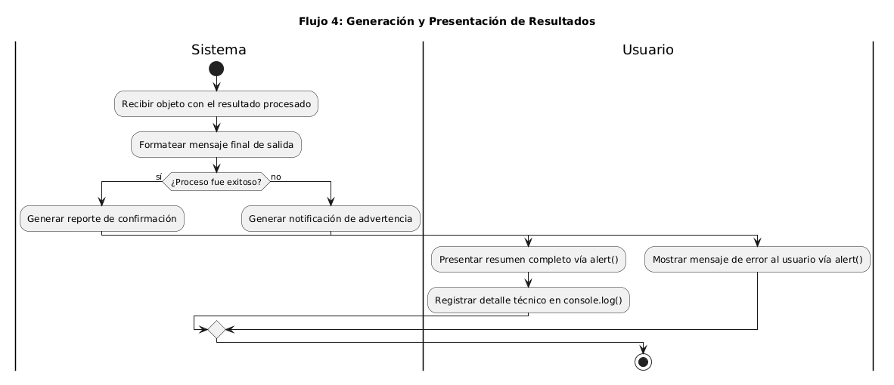

# 📊 Documentación de Diagramas de Actividades (AO3)

## 📌 Índice de Diagramas
1. [Flujo 1: Navegación por el Menú Principal y Selección de Opción](#flujo-1-navegación-por-el-menú-principal-y-selección-de-opción)
2. [Flujo 2: Ingreso y Validación de Datos de Entrada](#flujo-2-ingreso-y-validación-de-datos-de-entrada)
3. [Flujo 3: Procesamiento y Cálculo de la Lógica de Negocio](#flujo-3-procesamiento-y-cálculo-de-la-lógica-de-negocio)
4. [Flujo 4: Generación y Presentación de Resultados](#flujo-4-generación-y-presentación-de-resultados)

---

## 🛠️ Instrucciones de Edición y Visualización
Para visualizar o editar el código fuente de estos diagramas en PlantUML, se pueden utilizar las siguientes alternativas:

* **Editor Web Online (Recomendado sin instalación):**
  1. Copiar el contenido del archivo de fuente editable `.puml`.
  2. Pegar el código en PlantUML Online Editor o en el Servidor Oficial de PlantUML.
  3. Exportar la imagen actualizada en formato PNG o SVG.

* **Extensión local en Visual Studio Code:**
  1. Instalar la extensión **PlantUML** en VS Code (requiere Java instalado en el sistema).
  2. Abrir el archivo `.puml` deseado y presionar `Alt + D` para previsualizar el diagrama.

---

## 📐 Detalle de los Flujos de Negocio

### Flujo 1: Navegación por el Menú Principal y Selección de Opción
- **Descripción:** Controla la estructura principal de la aplicación mediante un bucle de menú interactivo. Captura la opción elegida por el usuario vía `prompt()`, valida que sea una alternativa aceptada y redirige la ejecución hacia el flujo de trabajo correspondiente.
- **Archivo ejecutable/editable:** [`actividad-flujo-1-menu.puml`](./actividad-flujo-1-menu.puml)
- **Diagrama visual:** 

---

### Flujo 2: Ingreso y Validación de Datos de Entrada
- **Descripción:** Modela el proceso iterativo de solicitud de datos al usuario. Garantiza la calidad de las entradas verificando que los campos no estén vacíos y que correspondan a valores numéricos dentro del rango permitido antes de su almacenamiento en memoria.
- **Archivo ejecutable/editable:** [`actividad-flujo-2-validacion.puml`](./actividad-flujo-2-validacion.puml)
- **Diagrama visual:** 

---

### Flujo 3: Procesamiento y Cálculo de la Lógica de Negocio
- **Descripción:** Detalla el procesamiento interno ejecutado exclusivamente por el Sistema. Toma los datos previamente validados, aplica reglas condicionales de negocio, calcula bonificaciones o importes y construye el objeto de resultados.
- **Archivo ejecutable/editable:** [`actividad-flujo-3-calculo.puml`](./actividad-flujo-3-calculo.puml)
- **Diagrama visual:** 

---

### Flujo 4: Generación y Presentación de Resultados
- **Descripción:** Representa el tramo final del ciclo de vida de la ejecución. Evalúa si el procedimiento concluyó con éxito o error para formatear los mensajes correspondientes y presentarlos visualmente al usuario a través de `alert()` y `console.log()`.
- **Archivo ejecutable/editable:** [`actividad-flujo-4-resultados.puml`](./actividad-flujo-4-resultados.puml)
- **Diagrama visual:** 