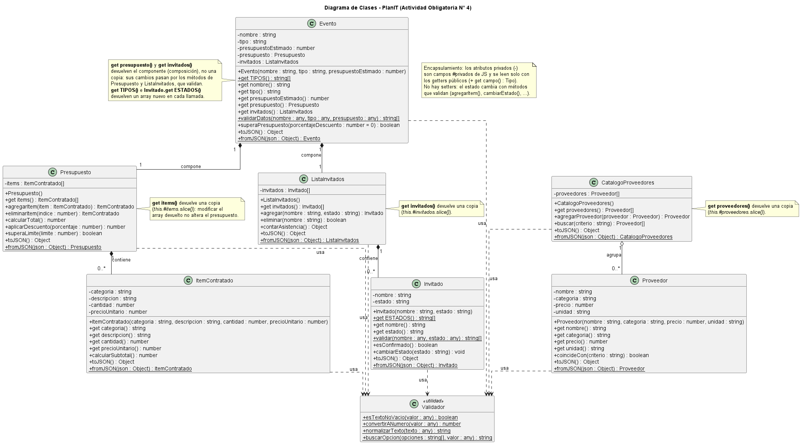

# Diagrama de Clases - PlanIT

- **Entrega:** Actividad Obligatoria N° 4
- **Rol:** Desarrollador JS POO (Lógica de Negocio)
- **Responsable:** Carola Benvenuto (@carolabenvenuto-uces)
- **Código fuente:** [`js/models/`](../../../js/models/)
- **Especificación:** [`spec-dev-poo.md`](../../03-specs/actividad-obligatoria-4/spec-dev-poo.md)

## Índice
1. [Diagrama](#diagrama)
2. [Descripción de las clases](#descripción-de-las-clases)
3. [Relaciones entre clases](#relaciones-entre-clases)
4. [Decisiones de diseño](#decisiones-de-diseño)
5. [Cómo editar el diagrama](#cómo-editar-el-diagrama)

---

## Diagrama

- **Archivo editable:** [`diagrama-clases.puml`](./diagrama-clases.puml)

---

## Descripción de las clases

| Clase | Archivo | Responsabilidad | Flujo |
| --- | --- | --- | --- |
| `Evento` | [`Evento.js`](../../../js/models/Evento.js) | Representa un evento social (cumpleaños, boda o salida casual) con su presupuesto estimado. Valida sus datos y compara el total del presupuesto con el límite. | 1. Crear evento / 2. Calcular presupuesto |
| `Presupuesto` | [`Presupuesto.js`](../../../js/models/Presupuesto.js) | Agrupa los ítems contratados de un evento y calcula el total, el total con descuento y la comparación con un límite. | 2. Calcular presupuesto |
| `ItemContratado` | [`ItemContratado.js`](../../../js/models/ItemContratado.js) | Representa un servicio contratado (por ejemplo, catering o sonido) con su cantidad y precio unitario, y calcula su subtotal. | 2. Calcular presupuesto |
| `CatalogoProveedores` | [`CatalogoProveedores.js`](../../../js/models/CatalogoProveedores.js) | Agrupa a los proveedores disponibles y permite buscarlos por nombre o categoría. | 3. Buscar en catálogo |
| `Proveedor` | [`Proveedor.js`](../../../js/models/Proveedor.js) | Representa un proveedor de servicios con su categoría, precio y unidad de cobro, y determina si coincide con un criterio de búsqueda. | 3. Buscar en catálogo |
| `ListaInvitados` | [`ListaInvitados.js`](../../../js/models/ListaInvitados.js) | Registra y elimina invitados de un evento y calcula la asistencia confirmada y pendiente. | 4. Gestionar invitados |
| `Invitado` | [`Invitado.js`](../../../js/models/Invitado.js) | Representa a un invitado y su estado de asistencia (Confirmado o Pendiente), y permite cambiarlo. | 4. Gestionar invitados |
| `Validador` | [`Validador.js`](../../../js/models/Validador.js) | Reúne validaciones y normalizaciones compartidas por las clases del dominio. Solo tiene métodos estáticos y no se instancia. | Todos |

---

## Relaciones entre clases

| Relación | Tipo | Multiplicidad | Justificación |
| --- | --- | --- | --- |
| `Evento` → `Presupuesto` | Composición | 1 a 1 | El presupuesto se crea con el evento y no existe sin él. |
| `Evento` → `ListaInvitados` | Composición | 1 a 1 | La lista de invitados pertenece a un único evento. |
| `Presupuesto` → `ItemContratado` | Composición | 1 a 0..* | Los ítems contratados forman parte del presupuesto y se serializan con él. |
| `ListaInvitados` → `Invitado` | Composición | 1 a 0..* | Los invitados se crean y registran dentro de la lista. |
| `CatalogoProveedores` → `Proveedor` | Agregación | 1 a 0..* | Los proveedores existen de forma independiente: el catálogo solo agrupa instancias ya creadas. |
| Clases del dominio → `Validador` | Dependencia | — | Usan sus métodos estáticos para validar y normalizar datos sin repetir código. |

---

## Decisiones de diseño

- **Encapsulamiento:** todas las propiedades son campos privados (`#`), expuestos con getters de solo lectura. El estado solo cambia mediante métodos que validan los datos (`agregarItem()`, `cambiarEstado()`, etc.), y los getters de colecciones devuelven copias de los arrays.
- **Getters en el diagrama (RC12):** el diagrama muestra todos los getters públicos reales de `js/models/` con la forma `+ get campo() : Tipo`, y los getters estáticos `Evento.TIPOS` e `Invitado.ESTADOS` como `{static} + get TIPOS() : string[]`. El atributo privado (`- campo : Tipo`) y su getter público se muestran juntos, porque el campo `#privado` no es accesible desde afuera y el getter es la única forma de leerlo. Ninguna clase declara setters. Las notas del diagrama aclaran que `items`, `invitados` y `proveedores` devuelven copias (`slice()`), mientras que `Evento.presupuesto` y `Evento.invitados` devuelven el componente, cuyos cambios pasan por métodos que validan.
- **Validaciones internas:** los constructores y los métodos lanzan un `Error` con un mensaje descriptivo ante datos inválidos. Los métodos estáticos `Evento.validarDatos()` e `Invitado.validar()` devuelven la lista de errores sin lanzar excepciones, para que el controlador pueda mostrar feedback en tiempo real.
- **Separación de responsabilidades:** las clases no manipulan el DOM, no registran eventos y no usan `prompt()`, `alert()` ni `console.log()`. El controlador (`js/script.js`) se encarga de la interacción con el usuario.
- **Serialización:** las clases persistibles implementan `toJSON()` y `static fromJSON(json)`. Las clases compuestas reconstruyen también a sus componentes; por ejemplo, `Evento.fromJSON()` reconstruye su `Presupuesto` y su `ListaInvitados`, lo que permite guardar y recuperar un evento completo desde Storage.
- **Composición vs. agregación:** se eligió composición cuando la parte no tiene sentido fuera del todo (un presupuesto o un invitado sin evento), y agregación para los proveedores, que existen por sí mismos y pueden formar parte de distintos catálogos.
- **Carga de los archivos:** las clases son scripts clásicos (sin `import`/`export`) y se cargan en orden de dependencia: `Validador`, `ItemContratado`, `Presupuesto`, `Invitado`, `ListaInvitados`, `Evento`, `Proveedor`, `CatalogoProveedores`.

---

## Cómo editar el diagrama

1. Abrir `diagrama-clases.puml` en VS Code con la extensión **PlantUML** instalada, o pegar su contenido en el editor de [plantuml.com](https://www.plantuml.com/plantuml).
2. Previsualizar los cambios con `Alt + D` (VS Code) o con la vista previa del editor web.
3. Exportar la imagen actualizada como `diagrama-clases.png` en esta misma carpeta, reemplazando la anterior.
4. Si se modifica una clase en `js/models/`, actualizar el diagrama y la descripción de este documento para mantenerlos coherentes con el código.
