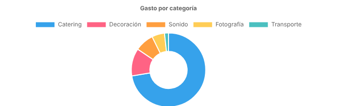
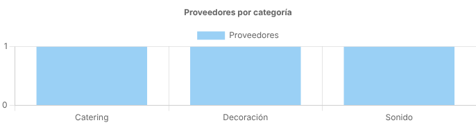

# Documentación de Librería Externa - Chart.js

## Información General
- **Nombre:** Chart.js
- **Versión:** 4.4.7
- **Repositorio:** https://github.com/chartjs/Chart.js
- **Documentación oficial:** https://www.chartjs.org/docs/latest/

## Propósito y Justificación
El Presupuesto y el Catálogo ya calculan datos agregados (subtotales por categoría en el modelo `Presupuesto`, y cantidad/rango de precio por categoría en `ApiService.resumirCatalogo()`), pero ambos se mostraban solo como texto plano. Chart.js permite visualizar esos datos existentes como gráficos interactivos (leyenda, tooltips, animación, responsive) sin tener que dibujar esa capa a mano. No duplica ninguna funcionalidad ya resuelta en el proyecto: no hay ningún gráfico implementado con código propio.

## Instalación e Integración
### Método utilizado: CDN
```html
<script src="https://cdn.jsdelivr.net/npm/chart.js@4.4.7/dist/chart.umd.js"
        integrity="sha384-zYPBGXwO4633CABX/5Spf6emCKUJCfoOkhOMYyxMsatqQZPnDblmmOewfjsIVWCM"
        crossorigin="anonymous" defer></script>
```
Se usa el build UMD (`chart.umd.js`, que ya viene minificado), cargado como script clásico, igual que Bootstrap. Se pide `chart.umd.js` y no `chart.umd.min.js` porque este último no existe en el paquete npm de la versión 4.4.7: jsDelivr lo genera al vuelo y advierte que no se debe usar SRI con archivos generados dinámicamente. El atributo `integrity` (SRI) hace que el navegador rechace el archivo si cambia; si eso ocurre, la app sigue funcionando y los gráficos muestran un aviso en lugar de quedar en blanco. Un módulo wrapper propio, `js/charts/graficoService.js`, encapsula la creación/actualización/destrucción de instancias de `Chart` (ver `docs/03-specs/segundo-parcial/spec-dev-libreria-externa.md`).

## Uso en el Proyecto

### Caso de Uso 1: Gasto por categoría (sección Presupuesto)
Gráfico de dona que se redibuja cada vez que cambian las cantidades o el descuento del presupuesto. Grafica los subtotales sin descuento que ya calculó el modelo (`resultado.subtotales`), con la categoría de cada ítem como etiqueta: el controlador no hace cuentas propias.

```javascript
function actualizarGraficoPresupuesto(ui, resultado) {
    if (!ui.graficoPresupuesto) return;
    const items = estadoApp.evento.presupuesto.items;
    pintarGrafico(ui.graficoPresupuesto, ui.avisoGraficoPresupuesto, {
        type: "doughnut",
        data: { labels: items.map((item) => item.categoria), datasets: [{ data: resultado.subtotales }] },
        options: { responsive: true, maintainAspectRatio: false,
            plugins: { title: { display: true, text: "Gasto por categoría" } } }
    }, resultado.subtotal > 0, "Todavía no hay gasto para mostrar en el gráfico.");
}
```

### Caso de Uso 2: Proveedores por categoría (sección Catálogo)
Gráfico de barras que consume directamente la salida de `ApiService.resumirCatalogo()` (rol Dev Async Fetch), sin duplicar ese cálculo, y se actualiza con cada búsqueda o cambio de filtro.

```javascript
function actualizarGraficoCatalogo(ui, resumenPorCategoria) {
    if (!ui.graficoCatalogo) return;
    const categorias = Object.keys(resumenPorCategoria);
    pintarGrafico(ui.graficoCatalogo, ui.avisoGraficoCatalogo, {
        type: "bar",
        data: {
            labels: categorias,
            datasets: [{ label: "Proveedores", data: Object.values(resumenPorCategoria).map((d) => d.cantidad) }]
        },
        options: { responsive: true, maintainAspectRatio: false,
            scales: { y: { beginAtZero: true, ticks: { precision: 0 } } },
            plugins: { title: { display: true, text: "Proveedores por categoría" } } }
    }, categorias.length > 0, "No hay proveedores para graficar con este filtro.");
}
```

### Estados sin gráfico y alto reservado
Cada `<canvas>` está dentro de un contenedor `[data-grafico-contenedor]` con alto fijo (220 px la dona, 180 px las barras), junto a un párrafo de aviso (`#aviso-grafico-presupuesto`, `#aviso-grafico-catalogo`). Las dos configuraciones usan `maintainAspectRatio: false` para ocupar ese alto en lugar de tomar una proporción propia, así el gráfico no desplaza el resto de la página. `pintarGrafico()` decide qué se ve:

- **Hay datos:** se muestra el gráfico y se oculta el aviso.
- **No hay datos** (presupuesto sin gasto, cantidad o descuento inválidos, catálogo cargando, en fallback o con un filtro sin resultados): se destruye el gráfico, se oculta el canvas y el aviso explica el motivo. Nunca queda un canvas en blanco ni un gráfico con datos de un cálculo anterior.
- **Chart.js no disponible** (CDN caído o archivo rechazado por el SRI): `GraficoService.renderizar()` devuelve `null` y se muestra el aviso correspondiente.

## Capturas de Pantalla



Ambas capturas tomadas con datos reales, sirviendo la app desde un servidor local (para que `fetch` del catálogo funcione) y con `node js/test/run-jasmine.js` en verde (330 specs, 0 failures) en el mismo estado del código.
