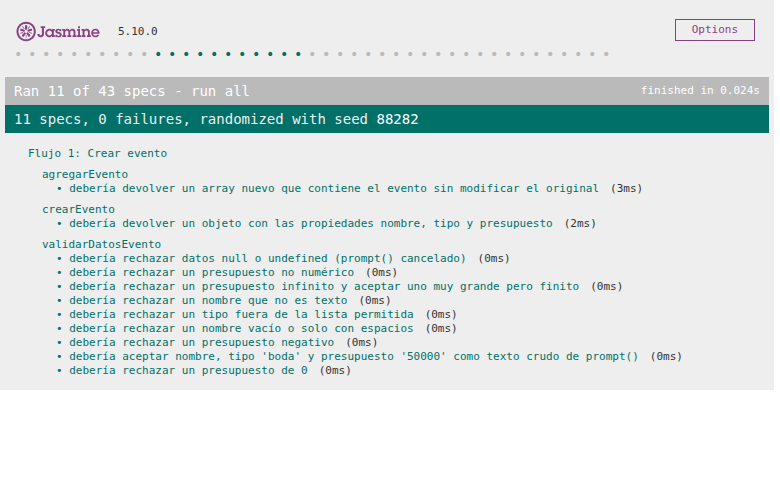
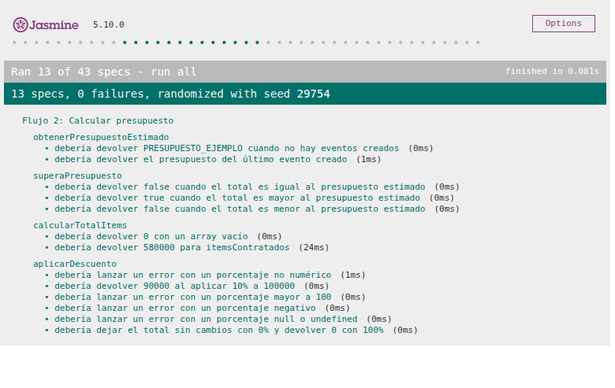
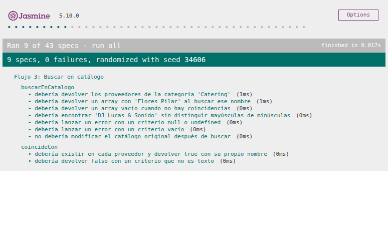
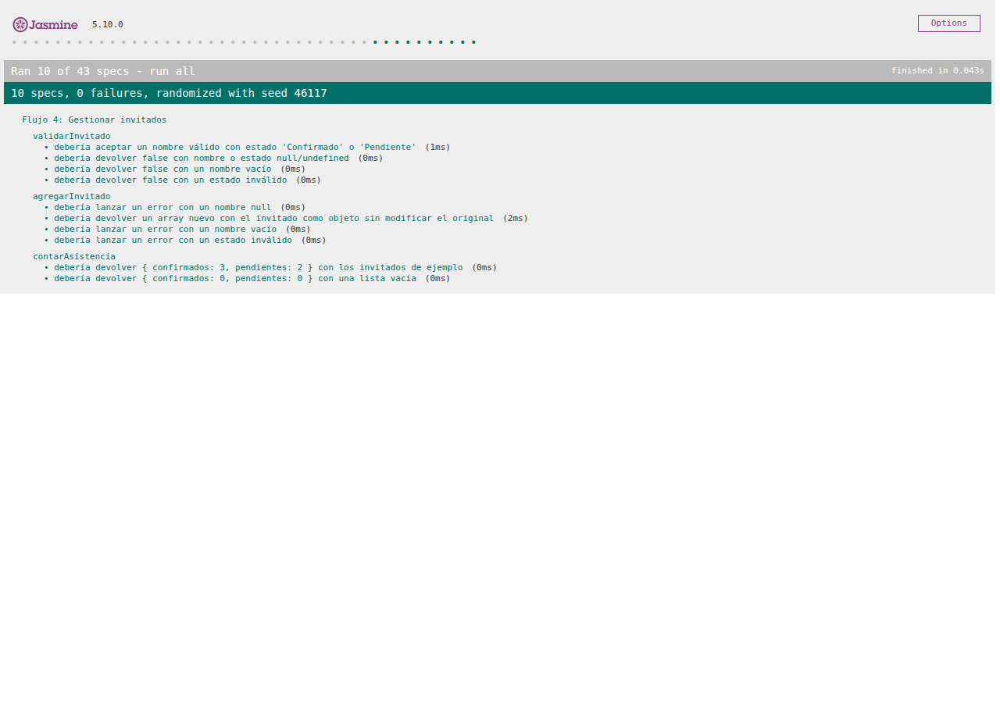

# Documentación de Testing - Suite Jasmine

## Índice
1. [Ejecución de Tests](#ejecución-de-tests)
2. [Suites de Tests](#suites-de-tests)
3. [Métricas de Cobertura](#métricas-de-cobertura)
4. [Capturas de Pantalla](#capturas-de-pantalla)
5. [Issues Conocidos](#issues-conocidos)

---

## Ejecución de Tests

### Pasos para Ejecutar
1. Abrir `js/test/test-runner.html` en el navegador (doble clic o arrastrándolo al navegador). Si el navegador bloquea archivos locales, levantar un servidor desde la raíz del repositorio con `npx http-server -p 8080` y abrir `http://localhost:8080/js/test/test-runner.html`.
2. Los tests se ejecutan automáticamente: el runner carga Jasmine 5.10.0 desde cdnjs, luego `../script.js` (código a testear) y por último `script.spec.js` (suites de tests).
3. Verificar resultados en la interfaz de Jasmine.

**Ejecución asistida con Playwright MCP:** desde VS Code, con el servidor `playwright` configurado en `.vscode/mcp.json`, se le pide a GitHub Copilot Agent Mode que abra `js/test/test-runner.html`, ejecute las suites y capture screenshots de los resultados.

### Interpretación de Resultados
- **Verde**: Tests pasando ✅
- **Rojo**: Tests fallando ❌
- **Amarillo**: Tests pendientes ⚠️

---

## Suites de Tests

Cada suite corresponde a uno de los 4 flujos de negocio modelados en `docs/05-diagramas/01-diagrama-de-actividades/` e implementados en `js/script.js`. Las firmas de las funciones se acordaron con el Desarrollador JavaScript en la issue [#72](https://github.com/carolabenvenuto-uces/planit/issues/72) y están documentadas en `docs/03-specs/actividad-obligatoria-3/spec-dev-javascript.md`. Solo se testean las funciones de negocio (puras); las funciones de interacción (`flujo*()` e `iniciarMenuPrincipal()`) quedan fuera porque usan `prompt()` y `alert()`.

Los 27 casos planificados inicialmente se implementaron en 32 `it()`. A partir de la review de la PR [#79](https://github.com/carolabenvenuto-uces/planit/pull/79) se agregaron casos con `null`/`undefined`, tipos incorrectos y valores muy grandes, y tests para `obtenerPresupuestoEstimado()`, hasta llegar a **43 `it()`**. Los casos agregados en la review se marcan con *(review)*.

### Suite 1: Crear evento

**Funciones Testeadas:**
- `validarDatosEvento(nombre, tipo, presupuesto)` - Valida nombre no vacío, tipo permitido y presupuesto mayor a 0; devuelve `true` / `false`.
- `crearEvento(nombre, tipo, presupuesto)` - Crea el objeto evento `{ nombre, tipo, presupuesto }`.
- `agregarEvento(eventos, evento)` - Devuelve un array nuevo con el evento agregado, sin modificar el original.

**Casos de Prueba:**
| # | Descripción | Tipo |
|---|-------------|------|
| 1 | `validarDatosEvento` acepta nombre, tipo "boda" y presupuesto "50000" (texto crudo de `prompt()`) | Happy Path |
| 2 | `validarDatosEvento` rechaza un nombre vacío o solo con espacios | Validación de Errores |
| 3 | `validarDatosEvento` rechaza un tipo fuera de la lista permitida (ej. "congreso") | Validación de Errores |
| 4 | `validarDatosEvento` rechaza un presupuesto de 0 | Caso Borde |
| 5 | `validarDatosEvento` rechaza un presupuesto negativo | Validación de Errores |
| 6 | `validarDatosEvento` rechaza un presupuesto no numérico ("abc") | Validación de Errores |
| 7 | `validarDatosEvento` rechaza datos `null` o `undefined` (`prompt()` cancelado) *(review)* | Validación de Errores |
| 8 | `validarDatosEvento` rechaza un nombre que no es texto *(review)* | Validación de Errores |
| 9 | `validarDatosEvento` rechaza un presupuesto infinito ("1e309") y acepta uno muy grande pero finito (`Number.MAX_SAFE_INTEGER`) *(review)* | Caso Borde |
| 10 | `crearEvento` devuelve un objeto con las propiedades `nombre`, `tipo` y `presupuesto` | Operaciones Arrays/Objetos |
| 11 | `agregarEvento` devuelve un array nuevo que contiene el evento y no modifica el array original | Operaciones Arrays/Objetos |

---

### Suite 2: Calcular presupuesto

**Funciones Testeadas:**
- `calcularTotalItems(items)` - Recorre los ítems contratados y suma sus subtotales.
- `aplicarDescuento(total, porcentaje)` - Aplica un descuento de 0 a 100; lanza un `Error` con un porcentaje inválido.
- `superaPresupuesto(total, presupuestoEstimado)` - Indica si el total supera el presupuesto estimado (usa `>`).
- `obtenerPresupuestoEstimado(listaEventos)` - Devuelve el presupuesto del último evento creado o `PRESUPUESTO_EJEMPLO` si no hay eventos.

**Casos de Prueba:**
| # | Descripción | Tipo |
|---|-------------|------|
| 1 | `calcularTotalItems(itemsContratados)` devuelve 580000 | Happy Path |
| 2 | `calcularTotalItems` con un array vacío devuelve 0 | Caso Borde |
| 3 | `aplicarDescuento(100000, 10)` devuelve 90000 | Happy Path |
| 4 | `aplicarDescuento` con 0% deja el total sin cambios y con 100% devuelve 0 | Caso Borde |
| 5 | `aplicarDescuento` lanza un error con un porcentaje negativo | Validación de Errores |
| 6 | `aplicarDescuento` lanza un error con un porcentaje mayor a 100 | Validación de Errores |
| 7 | `aplicarDescuento` lanza un error con un porcentaje no numérico | Validación de Errores |
| 8 | `aplicarDescuento` lanza un error con un porcentaje `null` o `undefined` *(review)* | Validación de Errores |
| 9 | `superaPresupuesto` devuelve `true` cuando el total es mayor al presupuesto estimado | Happy Path |
| 10 | `superaPresupuesto` devuelve `false` cuando el total es igual al presupuesto estimado | Caso Borde |
| 11 | `superaPresupuesto` devuelve `false` cuando el total es menor al presupuesto estimado *(review)* | Happy Path |
| 12 | `obtenerPresupuestoEstimado` devuelve `PRESUPUESTO_EJEMPLO` cuando no hay eventos creados *(review)* | Caso Borde |
| 13 | `obtenerPresupuestoEstimado` devuelve el presupuesto del último evento creado *(review)* | Happy Path |

---

### Suite 3: Buscar en catálogo

**Funciones Testeadas:**
- `buscarEnCatalogo(catalogo, criterio)` - Filtra los proveedores por nombre o categoría sin distinguir mayúsculas de minúsculas; lanza un `Error` con criterio vacío.
- `coincideCon(criterio)` - Método de cada proveedor de `catalogoProveedores` utilizado por la búsqueda.

**Casos de Prueba:**
| # | Descripción | Tipo |
|---|-------------|------|
| 1 | Buscar "Flores Pilar" en `catalogoProveedores` devuelve un array con ese proveedor | Happy Path |
| 2 | Buscar por la categoría "Catering" devuelve los proveedores de esa categoría | Operaciones Arrays/Objetos |
| 3 | La búsqueda no distingue mayúsculas de minúsculas ("dj lucas" encuentra "DJ Lucas & Sonido") | Caso Borde |
| 4 | Una búsqueda sin coincidencias devuelve un array vacío | Caso Borde |
| 5 | `buscarEnCatalogo` lanza un error con criterio vacío | Validación de Errores |
| 6 | `buscarEnCatalogo` lanza un error con criterio `null` o `undefined` *(review)* | Validación de Errores |
| 7 | El catálogo original no se modifica después de buscar (comparación profunda) | Operaciones Arrays/Objetos |
| 8 | Cada proveedor del catálogo tiene el método `coincideCon` y devuelve `true` con su propio nombre | Operaciones Arrays/Objetos |
| 9 | `coincideCon` devuelve `false` con un criterio que no es texto *(review)* | Validación de Errores |

---

### Suite 4: Gestionar invitados

**Funciones Testeadas:**
- `validarInvitado(nombre, estado)` - Valida nombre no vacío y estado "Confirmado" o "Pendiente"; devuelve `true` / `false`.
- `agregarInvitado(invitados, nombre, estado)` - Devuelve un array nuevo con el invitado agregado; lanza un `Error` con datos inválidos.
- `contarAsistencia(invitados)` - Recorre la lista y devuelve `{ confirmados, pendientes }`.

**Casos de Prueba:**
| # | Descripción | Tipo |
|---|-------------|------|
| 1 | `validarInvitado` acepta un nombre válido con estado "Confirmado" o "Pendiente" | Happy Path |
| 2 | `validarInvitado` devuelve `false` con un nombre vacío | Validación de Errores |
| 3 | `validarInvitado` devuelve `false` con un estado inválido (ej. "Declinado") | Validación de Errores |
| 4 | `validarInvitado` devuelve `false` con nombre o estado `null`/`undefined` *(review)* | Validación de Errores |
| 5 | `agregarInvitado` devuelve un array nuevo con el invitado como objeto `{ nombre, estado }` y no modifica el array original | Operaciones Arrays/Objetos |
| 6 | `agregarInvitado` lanza un error con un nombre vacío | Validación de Errores |
| 7 | `agregarInvitado` lanza un error con un estado inválido | Validación de Errores |
| 8 | `agregarInvitado` lanza un error con un nombre `null` *(review)* | Validación de Errores |
| 9 | `contarAsistencia` con los invitados de ejemplo devuelve `{ confirmados: 3, pendientes: 2 }` | Happy Path |
| 10 | `contarAsistencia` con una lista vacía devuelve `{ confirmados: 0, pendientes: 0 }` | Caso Borde |

---

## Métricas de Cobertura

### Resumen General
| Métrica | Valor |
|---------|-------|
| Total de Tests | 43 |
| Tests Pasando | 43 ✅ |
| Tests Fallando | 0 ❌ |
| Porcentaje de Éxito | 100% |

Ejecución final del 30/10/2026 con Playwright MCP sobre `http://localhost:8080/js/test/test-runner.html`: 43 specs, 0 fallas, orden aleatorio con seed 91363, duración de 0,418 s y 0 errores o advertencias en la consola. Por flujo: 11, 13, 9 y 10 specs.

### Cobertura por Tipo de Test
| Tipo | Cantidad | Porcentaje |
|------|----------|------------|
| Happy Path | 9 | 20,9% |
| Casos Borde | 9 | 20,9% |
| Validación de Errores | 19 | 44,2% |
| Operaciones Arrays/Objetos | 6 | 14,0% |

### Análisis de Cobertura de Código
**Metodología:** Se revisó manualmente cada función del código fuente y se verificó qué líneas son ejecutadas por los tests implementados. Se consideran líneas ejecutables las sentencias del cuerpo de cada función (sin contar llaves de cierre). Las funciones auxiliares se cubren de forma indirecta, a través de las funciones testeadas.

| Función | Líneas Totales | Tests | Líneas Cubiertas | Cobertura |
|---------|----------------|-------|------------------|-----------|
| `validarDatosEvento()` | 1 | 9 | 1 | 100% |
| `crearEvento()` | 4 | 1 | 4 | 100% |
| `agregarEvento()` | 1 | 1 | 1 | 100% |
| `calcularTotalItems()` | 6 | 2 | 6 | 100% |
| `aplicarDescuento()` | 4 | 6 | 4 | 100% |
| `superaPresupuesto()` | 1 | 3 | 1 | 100% |
| `obtenerPresupuestoEstimado()` | 3 | 2 | 3 | 100% |
| `buscarEnCatalogo()` | 9 | 7 | 9 | 100% |
| `coincideCon()` | 5 | 2 (+7 indirectos) | 5 | 100% |
| `validarInvitado()` | 1 | 4 | 1 | 100% |
| `agregarInvitado()` | 3 | 4 | 3 | 100% |
| `contarAsistencia()` | 8 | 2 | 8 | 100% |
| `obtenerErroresEvento()` *(indirecta)* | 9 | 9 | 9 | 100% |
| `obtenerTipoEvento()` *(indirecta)* | 6 | 10 | 6 | 100% |
| `convertirANumero()` *(indirecta)* | 5 | 16 | 5 | 100% |
| `obtenerEstadoInvitado()` *(indirecta)* | 6 | 8 | 6 | 100% |
| `esTextoNoVacio()`, `normalizarTexto()`, `calcularSubtotalItem()` *(indirectas)* | 3 | Indirectos | 3 | 100% |

**Cobertura Total Estimada:** 100% (75/75 líneas ejecutables) de las funciones incluidas en el plan de testing. Antes de la review era del 94% (68/72); los tests agregados cubrieron las 4 líneas pendientes e incorporaron `obtenerPresupuestoEstimado()`.

#### Líneas NO Cubiertas
Dentro de las funciones incluidas en el plan de testing no quedan líneas sin cubrir. Quedan fuera del plan:
- Las funciones puras de formato y apoyo a la interacción: `quiereReintentar()`, `describirIngreso()`, `formatearMoneda()` y `formatearListaProveedores()`.
- La capa de interacción con el usuario (`flujo*()`, `iniciarMenuPrincipal()` e `iniciarMenuAlTerminarCarga()`), porque usa `prompt()` y `alert()`.

---

## Capturas de Pantalla

### Tests Pasando

*Todos los tests ejecutándose correctamente: 43 specs, 0 fallas (captura tomada con Playwright MCP).*

### Vista Detallada de Suites
Cada captura muestra el runner filtrado por flujo con el parámetro `spec` de Jasmine.

*Suite 1: Crear evento (11 specs).*

*Suite 2: Calcular presupuesto (13 specs).*

*Suite 3: Buscar en catálogo (9 specs).*

*Suite 4: Gestionar invitados (10 specs).*

---

## Issues Conocidos

No se detectaron bugs en las ejecuciones del 28/10/2026 y del 30/10/2026: todas las specs pasaron y no se reportaron issues en GitHub.

---

## Limitaciones del Testing
- Tests síncronos únicamente (sin Promises/async-await).
- Sin cobertura automatizada de código: la cobertura se estima de forma manual.
- Requiere conexión a internet para cargar Jasmine desde el CDN.
- No incluye tests de integración con DOM, ya que la AO3 no utiliza manipulación del DOM ni eventos.
- Las funciones que interactúan con el usuario mediante `prompt()` y `alert()` no se testean: los tests cubren solo la lógica de negocio pura.

---

**Última Actualización:** 28/10/2026
**Tester/QA Engineer:** Carola Benvenuto (@carolabenvenuto-uces)  
**Colaboración con:** Desarrollador JavaScript - Facundo Guiraldes (@FacundoGuiraldes)