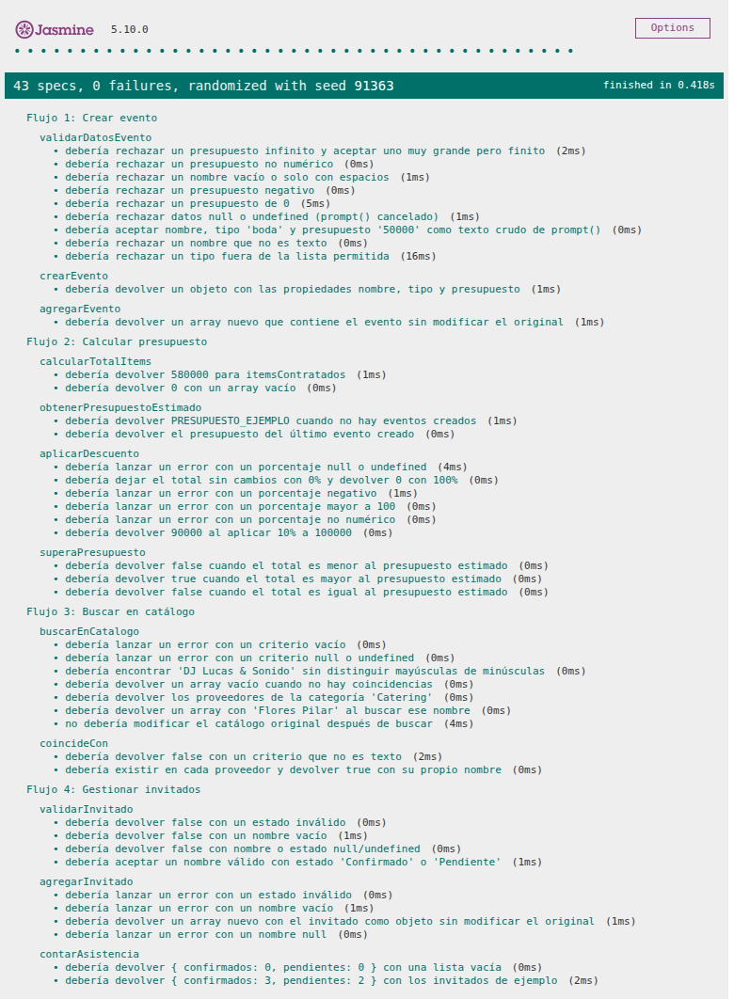
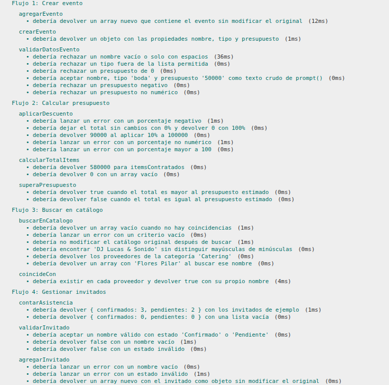

# Documentación de Testing - Suite Jasmine

## Índice
1. [Ejecución de Tests](#ejecución-de-tests)
2. [Suites de Tests](#suites-de-tests)
3. [Métricas de Cobertura](#métricas-de-cobertura)
4. [Capturas de Pantalla](#capturas-de-pantalla)
5. [Issues Conocidos](#issues-conocidos)

---

## Ejecución de Tests

### Pasos para Ejecutar
1. Abrir `js/test/test-runner.html` en el navegador (doble clic o arrastrándolo al navegador). Si el navegador bloquea archivos locales, levantar un servidor desde la raíz del repositorio con `npx http-server -p 8080` y abrir `http://localhost:8080/js/test/test-runner.html`.
2. Los tests se ejecutan automáticamente: el runner carga Jasmine 5.10.0 desde cdnjs, luego `../script.js` (código a testear) y por último `script.spec.js` (suites de tests).
3. Verificar resultados en la interfaz de Jasmine.

**Ejecución asistida con Playwright MCP:** desde VS Code, con el servidor `playwright` configurado en `.vscode/mcp.json`, se le pide a GitHub Copilot Agent Mode que abra `js/test/test-runner.html`, ejecute las suites y capture screenshots de los resultados.

### Interpretación de Resultados
- **Verde**: Tests pasando ✅
- **Rojo**: Tests fallando ❌
- **Amarillo**: Tests pendientes ⚠️

---

## Suites de Tests

Cada suite corresponde a uno de los 4 flujos de negocio modelados en `docs/05-diagramas/01-diagrama-de-actividades/` e implementados en `js/script.js`.

### Suite 1: Crear evento

**Funciones Testeadas:**
- _(a completar con las funciones de `js/script.js`)_

**Casos de Prueba:**
| # | Descripción | Tipo |
|---|-------------|------|
| 1 | Nombre, tipo "boda" y presupuesto 50000 son datos válidos y crean el objeto evento con esas propiedades | Happy Path |
| 2 | Agregar un evento válido a la colección aumenta su largo en 1 y la colección lo contiene | Operaciones Arrays/Objetos |
| 3 | Nombre vacío o solo con espacios es rechazado | Validación de Errores |
| 4 | Tipo fuera de la lista permitida (ej. "congreso") es rechazado | Validación de Errores |
| 5 | Presupuesto 0 es rechazado (debe ser mayor a 0) | Caso Borde |
| 6 | Presupuesto negativo o no numérico ("abc") es rechazado | Validación de Errores |

---

### Suite 2: Calcular presupuesto

**Funciones Testeadas:**
- _(a completar con las funciones de `js/script.js`)_

**Casos de Prueba:**
| # | Descripción | Tipo |
|---|-------------|------|
| 1 | La suma de varios ítems contratados es igual a la suma de sus subtotales | Happy Path |
| 2 | Un descuento del 10% sobre 100000 da un total final de 90000 | Happy Path |
| 3 | Una colección de ítems vacía da un total de 0 | Caso Borde |
| 4 | Un descuento de 0 deja el total sin cambios y uno de 100 lo lleva a 0 | Caso Borde |
| 5 | Un descuento negativo, mayor a 100 o no numérico es rechazado | Validación de Errores |
| 6 | Un total mayor al presupuesto estimado indica que se excede el presupuesto | Happy Path |
| 7 | Un total exactamente igual al presupuesto estimado no se considera excedido | Caso Borde |

---

### Suite 3: Buscar en catálogo

**Funciones Testeadas:**
- _(a completar con las funciones de `js/script.js`)_

**Casos de Prueba:**
| # | Descripción | Tipo |
|---|-------------|------|
| 1 | Buscar por el nombre de un proveedor existente devuelve un array con ese proveedor | Happy Path |
| 2 | Buscar por una categoría existente devuelve todos los proveedores de esa categoría | Operaciones Arrays/Objetos |
| 3 | La búsqueda no distingue mayúsculas de minúsculas | Caso Borde |
| 4 | Una búsqueda sin coincidencias devuelve un array vacío | Caso Borde |
| 5 | Un criterio de búsqueda vacío es rechazado | Validación de Errores |
| 6 | El catálogo original no se modifica después de buscar | Operaciones Arrays/Objetos |

---

### Suite 4: Gestionar invitados

**Funciones Testeadas:**
- _(a completar con las funciones de `js/script.js`)_

**Casos de Prueba:**
| # | Descripción | Tipo |
|---|-------------|------|
| 1 | Agregar un invitado con estado "Confirmado" lo incorpora a la lista con ese estado | Happy Path |
| 2 | Una lista con 3 confirmados y 2 pendientes da `{ confirmados: 3, pendientes: 2 }` | Operaciones Arrays/Objetos |
| 3 | Una lista vacía da `{ confirmados: 0, pendientes: 0 }` | Caso Borde |
| 4 | Un invitado con nombre vacío no se agrega | Validación de Errores |
| 5 | Un estado distinto de "Confirmado" o "Pendiente" es rechazado | Validación de Errores |
| 6 | Cada invitado se guarda como objeto con las propiedades `nombre` y `estado` | Operaciones Arrays/Objetos |

---

## Métricas de Cobertura

### Resumen General
| Métrica | Valor |
|---------|-------|
| Total de Tests | _(a completar)_ |
| Tests Pasando | _(a completar)_ ✅ |
| Tests Fallando | _(a completar)_ ❌ |
| Porcentaje de Éxito | _(a completar)_ |

### Cobertura por Tipo de Test
| Tipo | Cantidad | Porcentaje |
|------|----------|------------|
| Happy Path | _(a completar)_ | _(a completar)_ |
| Casos Borde | _(a completar)_ | _(a completar)_ |
| Validación de Errores | _(a completar)_ | _(a completar)_ |
| Operaciones Arrays/Objetos | _(a completar)_ | _(a completar)_ |

### Análisis de Cobertura de Código
**Metodología:** Se revisó manualmente cada función del código fuente y se verificó qué líneas son ejecutadas por los tests implementados.

| Función | Líneas Totales | Tests | Líneas Cubiertas | Cobertura |
|---------|----------------|-------|------------------|-----------|
| _(a completar)_ | | | | |

**Cobertura Total Estimada:** _(a completar)_

#### Líneas NO Cubiertas
- _(a completar)_

---

## Capturas de Pantalla

### Tests Pasando

*Todos los tests ejecutándose correctamente* _(captura a completar)_

### Vista Detallada de Suites

*Expansión de una suite mostrando tests individuales* _(captura a completar)_

---

## Issues Conocidos

_(A completar con los bugs detectados durante la ejecución, reportados como issues en GitHub.)_

---

## Limitaciones del Testing
- Tests síncronos únicamente (sin Promises/async-await).
- Sin cobertura automatizada de código: la cobertura se estima de forma manual.
- Requiere conexión a internet para cargar Jasmine desde el CDN.
- No incluye tests de integración con DOM, ya que la AO3 no utiliza manipulación del DOM ni eventos.
- Las funciones que interactúan con el usuario mediante `prompt()` y `alert()` no se testean: los tests cubren solo la lógica de negocio pura.

---

**Última Actualización:** _(a completar)_  
**Tester/QA Engineer:** Carola Benvenuto (@carolabenvenuto-uces)  
**Colaboración con:** Desarrollador JavaScript - Facundo Guiraldes (@FacundoGuiraldes)